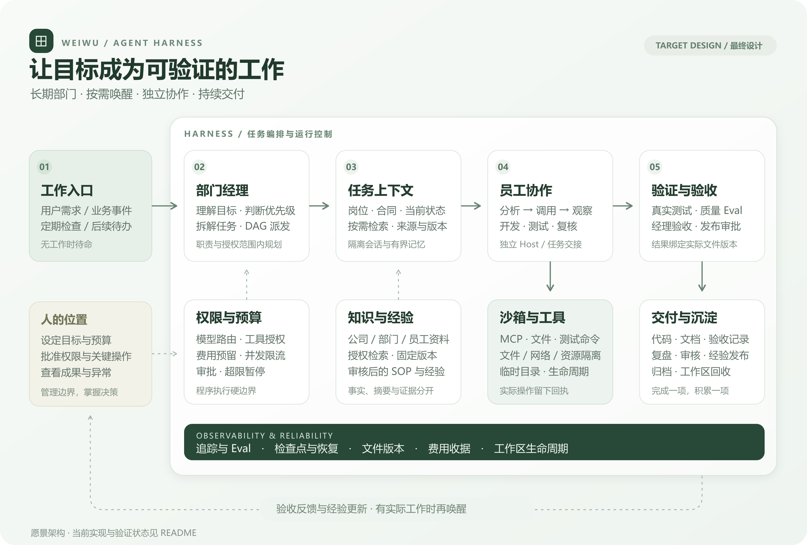

<div align="center">

# 为伍 · Weiwu

### 一个想法，一支团队。

让一个人管理一支持续工作的 AI 团队。

**长期部门 · 多 Agent 协作 · 公司知识 · 可验证交付**

[Windows 本机](docs/mvp-windows-quickstart-2026-10-07.md) · [Windows 访问 JJ](docs/jj-web-quickstart-2026-10-18.md) · [Harness 架构](#harness-如何运转) · [当前进度](#当前实现与验证)

</div>

---

为伍是一套面向 **AI 部门** 的 Agent Harness：用户设定部门目标、岗位、预算和授权边界，经理组织任务，员工调用工具完成工作，独立测试与验收确认交付，经验再回到部门知识中。

部门保留长期职责与项目记忆，按需求、事件和日程开展工作；没有实际工作时待命。用户通过网页查看成果、调整优先级，并处理需要自己决定的事项。

> **阅读说明**：产品介绍与架构图描述最终目标形态。当前支持 Windows 本机网页和 Windows 浏览器访问 JJ/Linux 部署；7×24 无人值守部门及部分监管、经验和资源治理能力仍在规划。实际完成情况见下方[验证状态](#当前实现与验证)。

## Harness 如何运转



<div align="center">
<sub>最终目标架构 · <a href="docs/assets/weiwu-harness.svg">查看矢量原图</a></sub>
</div>

### 从目标到交付

1. **接收工作**：用户需求、业务事件和定期检查进入部门待办，重复事件合并处理。
2. **经理规划**：结合部门职责、优先级和资源边界，形成任务 DAG、分工与验收标准。
3. **组装上下文**：按岗位和当前任务选择知识、经验与文件，固定来源版本，保留必要状态。
4. **员工协作**：每位员工拥有独立 Host 与会话，通过“分析、工具调用、观察结果”的循环推进任务，按合同交接。
5. **受控执行**：文件、命令和 MCP 操作经过授权；开发与测试在适配的沙箱中执行，保留实际回执。
6. **独立验收**：真实测试验证功能，Eval 检查质量，经理核对证据；关键发布操作交给用户确认。
7. **沉淀与继续**：交付代码、文档和报告，审核后发布经验，归档并回收临时工作区，等待下一项工作。

### 贯穿每一步的控制

| 控制面 | 最终设计中的职责 |
| --- | --- |
| **权限与审批** | 固定批准的模型、工具、资料和操作范围；超出授权转交用户决定 |
| **上下文与推理** | 有界上下文、按需检索与摘要；展示分析摘要、计划和依据，保持协议所需的推理状态 |
| **沙箱与资源** | 隔离工作目录、网络和进程，限制资源，管理依赖缓存及临时文件生命周期 |
| **预算与费用** | 用户设置总额度，经理分配任务预算；记录实际用量、预留与待核对收据 |
| **版本与恢复** | 任务、知识和产物绑定版本；保留检查点，恢复未完成工作，核对结果未知的操作 |
| **监管与 Eval** | 串联员工、任务、模型、工具、测试及评分；保留失败、复测和评测历史 |

## 部门是怎样工作的

以研发部门为例，你可以给它一个长期职责：

> 维护这个项目，持续处理已确认的需求与缺陷。开发后交给独立 QA，附上实际测试和运行说明。按预算安排工作，遇到发布、扩大权限或重大方案变化时让我决定。

目标使用体验是：经理整理待办与进度，开发员工维护实现，QA 独立验证，用户在同一个部门页面看到 **当前工作、今日成果、阻塞、待决策事项和费用**。

公司知识、项目状态、会话摘要和审核后的经验分别管理。知识帮助员工工作；任务完成与交付验收由真实文件、命令结果和正式记录证明。

## 快速开始

需要 Node.js `^22.19.0 || >=24`。在项目目录打开 PowerShell，首次安装：

```powershell
npm ci
npm --prefix services/agent-runtime ci
.\start-local-production.cmd
```

浏览器打开 **[http://127.0.0.1:4310/](http://127.0.0.1:4310/)**。

1. 在“模型目录”保存中转站、Key 和模型，验证连接及工具能力。
2. 首页多轮说明需求，检查并确认团队方案。
3. 在“项目与方案”批准运行，处理必要的命令审批。
4. 在运行页查看员工、任务、真实测试、费用和交付文件。
5. 中断后从原运行检查恢复条件，继续未完成任务。

当前 Windows 本机入口使用授权目录和逐次批准的命令。它使用当前用户的系统权限，**不等同于 OS 沙箱**。JJ/Linux 已接入 OpenShell 隔离设备，实际员工开发、独立 QA 和经理验收已验证；选择设备的方法见 [JJ 网页使用说明](docs/deployment-jj-quickstart-2026-10-09.md)。

默认数据位于 `.data/local`。接续已有项目应沿用原数据目录，同一目录只运行一份服务。完整步骤见 [Windows 使用说明](docs/mvp-windows-quickstart-2026-10-07.md)。API 服务应放在受控本机或认证代理后，直接暴露公网前需要补充相应访问控制。

<details>
<summary>无 Key 的流程演示</summary>

安装依赖后运行：

```powershell
npm run demo
```

打开 `http://127.0.0.1:4320/`。该入口使用固定模型响应和独立演示数据，适合了解审批、测试和交付流程；真实模型质量以实际验收为准。[演示说明](docs/mvp.md)

</details>

## 当前实现与验证

2026-10-21 正在加固企业任务隔离与恢复，企业 task profile 尚未开放。已完成恢复记录严格校验、Windows/JJ 文件锁私有适配器验证；实际运行尾部与清理等待已通过本地回归及独立复审。跨进程写入作用域、全部入口覆盖和恢复来源核对仍待接线。本轮代码尚未发布到 JJ 生产服务。[企业阶段清单](docs/superpowers/plans/2026-10-20-enterprise-foundations.md) · [写入锁证据](docs/validation/archive-writer-fence-primitive-2026-10-21.md) · [实际排空证据](docs/validation/runtime-writer-drain-2026-10-21.md)

同日核对固定 OpenShell 0.1.2 后，确认旧“删除成功”回执不能证明原沙箱已被删除。当前代码关闭沙箱回收按钮，历史记录保留并标为待物理复核；工作区副本清理与日志归档入口保留。下方历史 MVP 验证记录不能替代这项物理回收验证。[问题、修复与限制](docs/validation/openshell-cli-protocol-2026-10-21.md)

2026-10-13 已执行用户批准的有限 8K 续验准备。修复资源规划提示冗余导致的单请求预留超额，JJ 与本机各 87 项相关检查及类型检查通过，未扩大批准额度。真实规划调用返回格式不合格，已登记 $0.0008862，按授权停止追加；QA/经理未启动，旧 2048 快照与交付保留。后续须先修稳规划输出协议，不能把预算增加当作解决办法。[本轮真实结果与费用](docs/validation/recovery-output-real-2026-10-13.md)

2026-10-13 恢复资源方案新增逐任务单次输出额度，复用原 DSH，AI 可在用户允许范围内选择 8K/16K；网页展示前后差异，确认后才用于新快照和费用预留。已部署 JJ，本机与 JJ 各 86 项相关检查、类型检查及本机网页构建通过，未增加依赖或模型费用。原项目仍保留 2048 的批准快照；真实 8K 续验受原次数/金额限制，最终网页实机核对又遇到 JJ SSH 超时，均未宣称通过。见 [本轮实现、使用方法与续验核算](docs/validation/recovery-output-limits-2026-10-13.md)。

2026-10-13 完成恢复工具进度与最后一次正式交接的修复，复用现有 DSH，不增加依赖。JJ 上 236 项相关检查及类型检查通过，已完成发布和浏览器核对，原项目、费用及 493 份档案保持不变；本地构建通过。真实续验已恢复中转站调用并保留开发成果，但QA第4次回复达到原2048输出上限，被截断后停止，经理未启动；本轮登记$0.017061，未新增未知预留。真实 QA、经理及跨工作经验发布仍未通过。[工程修复与发布](docs/validation/recovery-continuity-2026-10-13.md) · [真实续验与逐次用量](docs/validation/recovery-continuity-real-2026-10-13.md)

2026-10-11 知识库新增跨工作“复用统计”，达到可配置的成功工作数后生成待审经验候选，沿用原审核与发布。已部署 JJ，相关 API22项、网页/效率8项、宿主21项及类型/构建通过。真实员工已完成三场景选用、独立 QA 原方法核对与经理验收，统计为1个成功工作；失败与修复保留。真实跨三工作候选及提速尚未验证。见 [使用与阶段证据](docs/validation/reuse-learning-2026-10-11.md)。

2026-10-11 公司批准方法已接入 DSH 官方目录和惰性加载器：员工可以检索获授权知识、Skill 和原已启用工具，读取后登记实际采用，正式工作记录只收录已验收尝试；恢复不重复计数。知识库新增方法发布入口，已部署 JJ，相关本地回归、类型与构建通过。后续真实文档选用结果见上条报告；外部插件自动发现和经验晋升尚未验收。[原接入步骤与阶段证据](docs/validation/company-capability-discovery-2026-10-11.md)

2026-10-11 已在 JJ 完成 30 分 3 秒隔离耐久验证：54 轮原员工测试通过，中途新进程恢复原沙箱与文件版本，临时文件清理后为 0。设置页增加只读保留建议，所有维护沿用预览和确认；原项目、档案及费用保留，本轮模型调用为 0。[使用方法](docs/storage-governance.md) · [实测与截图](docs/validation/endurance-retention-2026-10-11.md)

2026-10-11 已验证固定目标的小任务正常路径与服务重启恢复。预算不足时，通过真实 AI 资源候选和明确确认，只续未完成经理；开发及 QA 不重跑，9/9 真实测试与正式签收通过。累计费用及预留 $1.934692，未超过原 $2 授权。见 [本轮恢复报告与使用方法](docs/validation/resource-resume-2026-10-11.md)。

2026-10-10 在 JJ 复用已有员工交付，补充干净目录测试：原 QA 17/17、新测试 16/16，网页受控停止、服务重启后只续经理，正式验收通过。新增逐项命令证据 5/5；早期调用次数超限失败仍保留。见 [验收报告](docs/validation/delivery-acceptance-2026-10-10.md)和 [网页使用说明](docs/delivery-acceptance-quickstart.md)。

同日进一步通过网页完成多轮需求、确认 AI 方案、员工开发 `--help`、独立 QA 和经理 17+4 项复测、交付下载，并把工作登记到部门知识库。实际同任务知识复用对照已保存：总 Token 减少 1.94%、登记费用减少 1.37%，扣除审批等待后耗时增加 2.85%；不宣称普遍提速。见 [本阶段验收](docs/validation/userflow-acceptance-2026-10-10.md)和 [知识复用量化记录](docs/validation/knowledge-reuse-measurement-2026-10-10.md)。

最新 Windows MVP 已用配置的真实 Go 模型完成 Todo API 的正常交付和受控停止、服务重启、同版本恢复两条路径。代码、测试与报告由项目员工生成，失败与修复历史保留。

2026-10-09 的 JJ 迭代增加部门工作台、OpenShell 员工执行和可选 OpenRig 元数据队列。CLI 小任务已完成真实正常路径（17/17 测试）与受控重启恢复（10/10 测试、只续未完成经理）。OpenRig 负责岗位及工作项映射；为伍保留唯一执行、预算与正式验收入口。它目前不会自动领取并持续执行工作。详见 [本轮交付报告](docs/validation/phase1-phase2-delivery-2026-10-09.md)、[阶段进度](docs/validation/phase1-phase2-progress-2026-10-09.md)及 [OpenRig 集成边界](docs/openrig-integration.md)。

| 能力 | 状态与证据 |
| --- | --- |
| 多轮需求、方案修改、确认后组队 | 已实现；首页对话不占新项目执行预算，实际用量继续登记 |
| 开发、独立 QA、复核、经理验收 | 真实 Todo 正常路径通过；开发 12/12，QA 与复核各自 12/12 + 8/8 |
| 受控中断与重启恢复 | 原 MVP 真实路径通过；已完成开发节点未重复执行。新的企业 task profile 恢复仍待接线与验收 |
| 知识授权与固定版本 | 已验证；目录更新后，恢复仍引用原批准版本，私有资料保持授权范围 |
| 备份与交付文件恢复 | 已在隔离目录实际恢复关键数据及两项目交付文件，原环境保留 |
| 首页预算与费用交互 | 相关 74 项回归、类型检查和构建通过；中转站实际收费仍需核对 |
| 7×24 部门自主工作 | 目标设计；已有定时/监督基础，到期目前只生成待批准草案，多日试点未完成 |
| 复用统计、经验候选、Eval 与监管 | 已接通有界统计及待审候选，真实文档选用已完成1个成功工作；跨三工作候选/收益尚未实测，语义提炼与能力晋升待实现 |
| 容量盘点、确认维护 | 完成副本清理、可写目录盘点和热日志归档已有证据；OpenShell 物理回收未证实，当前代码关闭回收入口，旧回执待复核；自动回收未实现 |
| 自动工作区回收、推理过程展示 | 已纳入下一阶段需求，尚未完整接通和验收 |

详细证据见 [验收报告](docs/mvp-acceptance-2026-10-07.md)、[修复清单](docs/mvp-fixed-issues-2026-10-07.md)及[需求对话预算变更](docs/validation/conversation-budget-2026-10-07.md)。原始运行卷宗保留在本机；公开源码提交不包含凭据、数据库或完整私有上下文。

仍有历史未知费用预留、员工报告叙述误差，以及跨机器凭据迁移、长期无人值守和当前 Windows OS 隔离尚未验证的限制，均在验收报告中注明。

## 技术底座与复用原则

| 层次 | 当前底座 |
| --- | --- |
| 网页与管理 API | React、TypeScript、Express |
| 员工与协作 | DeepSeek Harness、Cordis、DSH AgentTeams |
| 业务状态 | 本机 PGlite；已有 PostgreSQL/pgvector 部署路径 |
| 公司知识 | Markdown/Obsidian、授权清单、不可变版本和检索索引 |
| 执行与追溯 | 本机执行与 Docker 路径、任务合同、检查点、审批和费用记录 |
| JJ 隔离执行 | NVIDIA OpenShell 0.1.2；固定 Node 镜像、资源和网络策略、文件版本校验 |
| 可选部门工作项 | OpenRig 0.6.6 官方持久队列与岗位元数据，禁止第二套员工调度 |

**现成组件优先，产品适配保持清晰。** 组织管理、工具协议、追踪与评测优先评估现有项目；为伍负责部门职责、业务授权、正式验收和各组件之间的可靠连接。Paperclip、WakuAgent、官方 MCP 与 Eval 工具是选型候选，不代表已经安装或接入。

## 设计与调研

- [长期研发部门：上下文、成本、知识、经验、沙箱与资源治理](docs/research/long-running-rd-reuse-2026-10-07.md)
- [WakuAgent：监视、Eval 与可复用边界](docs/research/waku-agent-observability-eval-2026-10-08.md)
- [员工上下文管理](docs/context-management.md) · [员工独立运行时](docs/employee-runtime.md)
- [知识库与 Obsidian](docs/obsidian.md) · [工作资料与办公文件](docs/work-files.md)
- [MCP 与浏览器工具](docs/browser-mcp.md) · [自动化与经验](docs/automation-learning.md)
- [文件合同与交接](docs/reliable-handoff.md) · [受控返工](docs/controlled-rework.md)
- [中断恢复](docs/checkpoint-resume.md) · [本机执行边界](docs/local-execution.md)
- [执行策略](docs/execution-policy.md) · [模型能力验证](docs/model-capabilities.md) · [部署说明](docs/deployment.md)

## 工程检查

```powershell
npm run build
npm run test:rules
npm run runtime:test:portable
npm run test:integration
```

类型检查、构建与回归结果见 [提交检查](docs/validation/readme-release-check-2026-10-08.md)、[2026-10-11 历史生命周期验收](docs/validation/sandbox-lifecycle-2026-10-11.md)和 [2026-10-21 OpenShell 协议纠正](docs/validation/openshell-cli-protocol-2026-10-21.md)。网页“系统设置 → 文件与数据容量”可核对沙箱、清理已核对的工作区副本与归档完成日志；当前代码暂不提供沙箱删除。使用步骤及边界见 [容量维护说明](docs/storage-governance.md)。

本地回归优先使用隔离数据库和协议测试服务。真实模型、Docker、语义检索及浏览器验证有独立前提；跳过或模拟结果与真实业务验收分别记录。完整检查边界见 [运行时说明](docs/employee-runtime.md)与[验收报告](docs/mvp-acceptance-2026-10-07.md)。

## 目录

```text
apps/web               网页工作台
apps/api               部门、项目、权限、费用与管理 API
packages/contracts     共享合同与确定性校验
services/agent-runtime DSH / AgentTeams 运行器与适配
services/embedding     本地语义检索组件
scripts                启动与工程验证
tests                  产品回归与合成夹具
docs                   使用说明、架构、调研与验证报告
```

---

<div align="center">
<strong>为伍 · 让目标有团队，让交付有依据。</strong>
</div>
