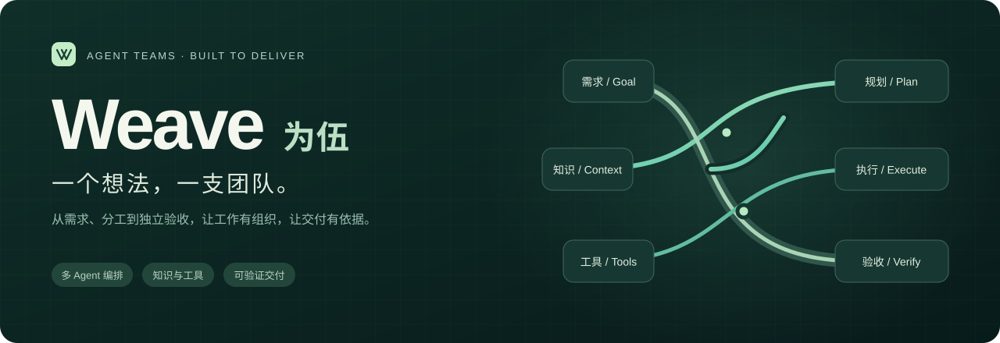
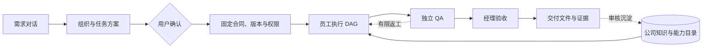

<div align="center">



**把自然语言需求，编织成一支有分工、有边界、能验收的 AI 团队。**

[](https://github.com/xindongliu594/weave/actions/workflows/core.yml)


[快速开始](#quick-start) · [执行流程](#workflow) · [核心能力](#capabilities) · [当前进度](#status) · [文档导航](#docs)

</div>

---

## 把目标交给团队，把依据留给你

**Weave（为伍）是一套基于 DeepSeek Harness 的多 Agent 工作平台。** 用户在网页中讨论需求、确认组织与任务方案，由员工执行、独立 QA 验证、经理核对交付，并保留知识引用、工具回执、审批与费用记录。

我们希望把现实中部门的工作方式带入 Agent：职责可以延续，成果可以追溯，经验能够复用，工具能力可以扩展。研发、办公和运维共享同一套授权与交付机制。

> 当前为开发中的 MVP。本文的「执行流程」描述产品目标架构；各项能力的实际完成范围见[当前进度](#status)。长期无人值守、企业任务的步骤级恢复等能力仍在推进。

<a id="workflow"></a>
## 从一个需求，到一次有依据的交付


<p align="center"><sub>产品目标架构 · <a href="docs/assets/weiwu-harness.svg">查看矢量图</a></sub></p>



**权限、预算、上下文、版本、检查点与审计贯穿整条链路。** 用户既能管理过程，也能找到支撑结论的文件、命令结果与验收记录。

<a id="capabilities"></a>
## 团队如何工作

| 能力 | 工作方式 |
| --- | --- |
| **任务驱动的组织** | 多轮澄清需求后生成角色、任务依赖和验收合同；用户确认后才创建正式部门与项目 |
| **7 类编排模板** | 基于业务需求选择并参数化编排，将方案编译到同一 DAG，统一进行依赖、交付物与职责校验 |
| **员工独立上下文** | 每位员工独立 Host / 会话，按需检索授权资料、加载 Skill 与工具，固定引用版本 |
| **插件与工具复用** | 沿用 DSH 工具注册与插件机制，公司私有能力与兼容社区插件进入共同目录，按员工和项目授权 |
| **可核对的交付** | 以文件、测试命令回执和结构化交接约束完成声明；产出者、QA、经理承担不同职责 |
| **受控执行与成本** | 本机目录和命令授权、JJ/OpenShell 隔离执行、额度预留与结算、未知结果保留核对入口 |
| **知识与经验积累** | 工作关联知识来源和实际采用记录，支持复用统计、经验候选与审核发布；可执行能力的自动晋升持续建设 |
| **执行观测与评测** | 关联运行、任务、会话、模型与工具事件，结合七维评测集核对结果、证据、稳定性、成本和权限 |

**内置编排：** 顺序交接 · 并行汇总 · 条件路由 · 经理分工 · 带返工审查 · 映射归约 · 方案评审。

编排模板的定义与适用边界见[编排设计](docs/superpowers/specs/2026-10-19-orchestration-pattern-library-design.md)；插件支持范围与操作见[插件安装](docs/plugin-installation.md)。

<a id="quick-start"></a>
## 在本机开始

需要 **Node.js 22.19+（22.x）或 24+**、npm、Git。模型推理使用你配置的 API；网页、数据库、调度与工具在部署机器上运行。

```powershell
git clone https://github.com/xindongliu594/weave.git
cd weave
npm ci
npm --prefix services/agent-runtime ci
.\start-local-production.cmd
```

打开 **http://127.0.0.1:4310/**，保持启动终端运行。

1. 按页面提示完成管理员初始化，在模型目录保存 API URL 与 Key，检查模型能力。
2. 在首页描述需求，继续补充或修改方案，确认后创建部门与项目。
3. 核对模型、资料、工具权限和预算，批准执行；需要时处理单次操作审批。
4. 在运行页面查看任务、员工、测试、费用和交付文件。

默认持久数据位于 `.data/local`，接续旧项目应使用原数据目录；同一目录只运行一份服务。开发模式可使用 `npm run local`。完整操作见 [Windows 使用说明](docs/mvp-windows-quickstart-2026-10-07.md)。

<details>
<summary><strong>先体验界面：无需 API Key 的独立演示</strong></summary>

```powershell
npm run demo
```

访问 http://127.0.0.1:4320/。演示使用固定响应和独立数据，适合了解对话、审批和交付流程；真实模型质量以实际验收记录为准。[演示说明](docs/mvp.md)

</details>

<details>
<summary><strong>使用 JJ / Linux 作为执行机器</strong></summary>

可以从 Windows 浏览器访问 JJ 上的网页服务。后端、数据库、工具和员工执行留在 JJ，模型推理使用已有 API。需要隔离执行时，由管理员配置 OpenShell，再将设备和相应权限授予项目。

[Windows 访问 JJ](docs/jj-web-quickstart-2026-10-18.md) · [JJ 部署与设备选择](docs/deployment-jj-quickstart-2026-10-09.md) · [OpenRig 集成边界](docs/openrig-integration.md)

</details>

> Windows 本机执行使用当前用户的系统权限和批准目录，不能等同于操作系统沙箱。JJ/Linux 的 OpenShell 是独立执行路径。API 与管理服务应运行于受控网络，并遵守相应的认证和授权配置。

<a id="status"></a>
## 当前进度与真实证据

这份仓库同时保留可运行的 MVP 路径与企业能力的开发代码。**历史业务验收、当前工程回归和未来规划各有适用范围。**

| 范围 | 当前状态 | 查看依据 |
| --- | --- | --- |
| **需求 → 组队 → 执行 → 独立验收 → 交付** | 已有真实模型 Todo API / CLI / 办公小任务证据 | [MVP 验收](docs/mvp-acceptance-2026-10-07.md) · [交付复核](docs/validation/delivery-acceptance-2026-10-10.md) |
| **原 MVP 中断与重启续跑** | 已有真实受控中断与重启记录；完成节点不重复执行 | [资源与续跑](docs/validation/resource-resume-2026-10-11.md) |
| **兼容工具插件安装与授权** | 已验证安装、启用、员工发现与调用、未授权拒绝；插件类型分别验证 | [安装与调用证据](docs/validation/plugin-plug-and-play-2026-10-23.md) |
| **成员工作台、观测、七维评测** | 已有工程实现；core-v2 为 23 项通过、9 项待真实证据 | [并行阶段报告](docs/validation/p0-parallel-2026-10-29.md) |
| **企业备份与隔离恢复** | 已有原生 PostgreSQL 隔离目录恢复证据 | [备份验证](docs/validation/enterprise-backup-native-2026-10-29.md) |
| **企业任务步骤级恢复** | 来源、初始化和运行层正在集成；企业 task profile 尚未开放，网页/JJ 真实续跑待验收 | [来源基础验证](docs/validation/recovery-source-primitives-2026-10-30.md) · [恢复接线计划](docs/superpowers/plans/2026-11-01-task-recovery-runtime.md) |
| **长期自主工作与自动晋升** | 已有部门、调度草案、知识和候选基础；多日无人值守及经验自动转成可执行能力尚未完整验收 | [长期部门设计](docs/research/long-running-rd-reuse-2026-10-07.md) |

**已知边界：** 部分历史未知费用仍保留预留；原生插件网页、后台服务类型不保证零适配；OpenShell 物理沙箱删除尚未证实，当前关闭其回收入口。[容量维护与限制](docs/storage-governance.md) · [协议核对](docs/validation/openshell-cli-protocol-2026-10-21.md)

阶段失败、修复和未验证事项保留在报告中。公开仓库不包含 API Key、生产数据库或完整私有运行上下文。

## 架构与复用

| 层次 | 当前技术与职责 |
| --- | --- |
| **网页 / API** | React · TypeScript · Express；组织、项目、授权与审批 |
| **Agent 运行与协作** | DeepSeek Harness · Cordis · DSH AgentTeams；Host、会话、工具与任务协作 |
| **数据与知识** | PGlite / PostgreSQL · pgvector · Markdown / Obsidian；业务状态、授权检索与版本引用 |
| **执行隔离** | 本机执行设备 · JJ/Linux OpenShell；工作目录、命令与沙箱策略 |
| **观测与评测** | OpenTelemetry · Promptfoo；有界事件摘要、七维数据集和证据检查 |
| **为伍的连接层** | 组织和任务合同、能力授权、预算账本、交接验收、产物和恢复记录 |

**先调研，优先复用，再补连接。** 插件、Skill、MCP 沿用各自标准和加载方式；为伍负责共同的发现、授权、版本与证据关联。[插件扩展说明](docs/plugin-installation.md) · [员工运行时](docs/employee-runtime.md)

<a id="docs"></a>
## 文档导航

| 想了解什么 | 从这里开始 |
| --- | --- |
| **安装与日常使用** | [Windows 上手](docs/mvp-windows-quickstart-2026-10-07.md) · [JJ 网页访问](docs/jj-web-quickstart-2026-10-18.md) · [交付验收](docs/delivery-acceptance-quickstart.md) |
| **上下文与协作** | [上下文管理](docs/context-management.md) · [结构化交接](docs/reliable-handoff.md) · [受控返工](docs/controlled-rework.md) |
| **知识与能力** | [知识库](docs/obsidian.md) · [插件安装](docs/plugin-installation.md) · [MCP](docs/browser-mcp.md) · [办公资料](docs/work-files.md) |
| **权限与可靠性** | [执行策略](docs/execution-policy.md) · [检查点恢复](docs/checkpoint-resume.md) · [文件与容量](docs/storage-governance.md) |
| **质量与项目进度** | [评测集](tools/evaluations/README.md) · [加固进度](docs/validation/hardening-progress-2026-10-29.md) · [目标架构](docs/assets/weiwu-harness.svg) |

## 开发与工程检查

```powershell
npm run build                  # 类型检查与网页构建
npm run test:rules             # 任务合同与规则
npm run runtime:test:portable  # 运行时工程测试
npm run test:integration       # 隔离 PGlite 集成测试
```

隔离集成测试使用模拟模型，不能代替真实模型、原生 PostgreSQL 锁、Docker 或 JJ/OpenShell 验收。各类外部环境需按对应说明准备，检查结果以具体报告为准。

```text
apps/web                 网页工作台
apps/api                 组织、项目、授权、预算与管理 API
packages/contracts       共享合同与确定性校验
services/agent-runtime   DSH / AgentTeams 运行器与适配
services/embedding       检索组件
tests                    规则、组件、接口与工程验证
tools/evaluations        评测数据与检查入口
docs                     使用、设计、调研与验收证据
```

---

<p align="center"><strong>Weave · 为伍</strong><br/><sub>让目标有团队，让交付有依据。</sub></p>
