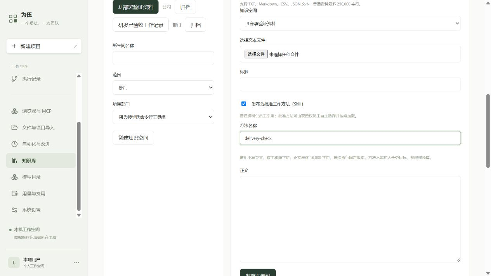

# 公司能力发现与采用记录：阶段验收

日期：2026-10-11。结论：本批代码、相关本地回归、JJ 部署和真实网页入口验证完成。复用当前 DSH Skill Provider、知识版本清单、工具 Schema 和持久事件；没有新增依赖或外部网关。本批没有调用真实模型，员工自主选择的实际质量仍未验证，不能把协议夹具算成模型验收。

## 本批交付

- 知识库支持明确保存“批准工作方法（Skill）”，普通资料和方法状态分开。编辑保留工作来源，取消勾选可把新修订改回普通资料；旧批准版本保留。
- 公司/部门/员工方法按原知识空间授权进入员工目录，还须开启知识检索及读取。目录仅含摘要与固定版本引用，官方 DSH Provider 按需读取正文并校验 SHA256，不复制整个知识库到运行档案。
- `capability_search` 检索该员工的知识、批准方法和原已启用工具；无匹配返回空结果，检索失败明确报错。发现不安装工具、不扩大权限。
- `capability_use` 记录实际采用的知识或 Skill：先核对原读取回执和固定版本，再绑定当前任务/尝试。登记状态是采用声明；成功由真实交付测试及宿主验收确认。异步校验期间任务更换会拒绝登记。
- 同一尝试恢复时通过原持久 sourceKey 去重。正式工作记录只收录最后封存成功尝试的采用来源，失败尝试、仅命中和仅读取不计入。工具使用继续沿用原调用回执。
- 网页时间线显示发现和采用说明；正式工作记录的“查看登记内容与知识引用”保存采用步骤、源版本与哈希，可继续登记进已有知识库。

边界：本批只检索批准快照中的资料及原已授权工具；后来添加的方法供新批准运行使用，不静默替换活动任务的上下文。每员工公司方法上限 50 个、方法正文最多 16,000 字符；检索每类最多 6 条。外部 Obsidian 编辑产生的修订按普通资料处理，需在网页重新明确发布方法。

## 怎么使用

1. 打开 [JJ 为伍网页](http://127.0.0.1:4312/#knowledge)。这个地址使用现有 Windows→JJ 本地隧道，数据在 JJ 后端。
2. 在“知识库”选择公司或部门知识空间，填写标题和方法正文，勾选“发布为批准工作方法（Skill）”，填写例如 `delivery-check` 的方法名称，保存。普通参考资料保持不勾选。
3. 在“部门与员工”编辑页，为员工勾选相应知识空间，并开启“知识检索”和“知识读取”。这沿用原授权，不必逐次为员工指定具体方法。
4. 发起新任务并确认方案。员工可以检索目录，选择适用方法并按需加载；没有适用结果时继续原任务。模型仍可能选择不佳，当前机制不能保证其必然正确选用。
5. 在执行记录查看检索/读取/采用过程；完成验收后，在知识库“工作记录”选择该运行，查看已采用的固定来源，再按原入口登记工作知识。

界面截图来自真实 JJ 网页；只检查和展开表单，没有点击保存，没有向生产知识库添加测试资料：

## 验证证据

| 验证 | 实际结果 | 证据 |
| --- | --- | --- |
| 运行时与持久化 | 27/27：员工权限、方法惰性加载、冷恢复、采用去重、尝试切换、目标门禁及事件游标 | [运行时输出](evidence/company-capability-discovery-2026-10-11/final-core.txt) |
| API、知识与备份 | 10/10：公司方法 2、原知识检索 1、正式工作登记 4、原加密备份/隔离恢复 3 | [API 输出](evidence/company-capability-discovery-2026-10-11/final-api.txt) |
| 界面与授权合同 | 9/9：显式发布、普通资料、编辑来源保留、目录容量和批准方法合同 | [界面输出](evidence/company-capability-discovery-2026-10-11/final-ui.txt) |
| 实际 DSH 请求装配 | 2/2：请求确实提供发现和采用工具，首次目录不包含全部方法正文；模型为本地协议替身 | [工具 Schema 输出](evidence/company-capability-discovery-2026-10-11/model-tool-schemas.txt) |
| 类型、网页构建 | 均 exit 0；保留已有大于 500 kB bundle 提示 | [类型](evidence/company-capability-discovery-2026-10-11/types-final.txt) · [构建](evidence/company-capability-discovery-2026-10-11/build-final.txt) |
| 独立代码审查 | 一次 fresh-context 审查，0 Critical / 0 Important / 0 Minor；审查者独立核心 6/6 | [审查结论](evidence/company-capability-discovery-2026-10-11/review.md) |
| JJ 固定发布验证 | 发布目录下无模型回归 14/14，服务恢复健康，原数据不变 | [部署输出](evidence/company-capability-discovery-2026-10-11/jj-deployment.txt) · [部署清单](evidence/company-capability-discovery-2026-10-11/deployment.json) |
| 真浏览器 | 方法选项、名称输入和正文 16,000 限制正常；检查后还原选项，未保存资料 | [在线核对](evidence/company-capability-discovery-2026-10-11/live.json)及上述截图 |

RED 证据也保留在同一目录：公司目录不存在、方法元数据被旧 schema 去除、非法发布被接收、重复长行切片 ID、采用工具缺失、尝试切换归属错误、工作文档缺少采用来源、网页缺少发布入口。均有随后相关 GREEN 输出。

## 修复问题

1. 知识长行包含重复片段时，多个片段生成相同 ID，保存遇到唯一约束失败。新生成的长行切片 ID 加入片段偏移；已有文档、切片和引用没有重写。
2. 采用核验期间可能发生任务尝试切换。写回执前再次核对活动尝试，防止归属到错误尝试。
3. 工作登记原本没有明确的实际采用版本关系。新采用记录关联已封存尝试，重复事件不增加记录，旧工作没有新采用事件时内容格式保持原样。
4. 原 Skill 入口只覆盖运行内方法。公司方法现在通过当前 DSH 官方 Provider 惰性加载，仍保持普通资料与批准指令的边界。

测试过程中最初遇到 Windows 沙箱临时目录 ENOENT，改为在批准的本地测试环境运行；API 500 随后定位到上述切片碰撞并修复。追加请求装配断言最初误读 `options.tools`，按实际 `GenerateOptions.tools` 修正测试后通过，没有因此修改产品行为。

## 部署、数据与费用

- JJ 运行目录：`/home/jj/.local/share/weiwu/releases/weiwu-company-capabilities1-20261011`。
- 原目录 `/home/jj/.local/share/weiwu/releases/weiwu-retention1-20261011` 和全部共享依赖保留；仅切换原用户服务的代码目录，没有改变凭据、权限、OpenShell 配置或预算。
- 部署代码来源：`63c646cf1ea9837722376755f019d269282dfcda`；部署包 SHA256：`303dec35f932eccc4afaac3860a5bae32a1a48e269dfee04ab60648979aa13af`。随后仅补充测试断言及验收文档，没有修改部署产品实现。
- 部署前后 6 个项目的版本和状态相同，362 条用量记录的金额及 Token 相同；原运行档案 332 文件 / 366,882,161 字节，逐文件哈希汇总相同。没有删除、压缩或改写原交付。
- 原已验收 CLI 来源 `f86bfd4f-265d-43f4-ad30-5c5c1140dd92` 的正式工作 API 仍可读取，旧记录不会凭空产生采用计数。本批没有创建生产模型运行，因此没有新的真实运行 ID。
- 本批真实模型调用 0、模型费用 0。原 JJ 累计 $2 授权不变；登记费用与旧预留共 $1.934692，余量约 $0.065308；未知费用没有清零或重放。

## 未验证与后续范围

- 真实模型自主检索与选择、中文检索质量、部分适用判断：未验证。已有协议测试证明工具和权限连接，不能证明模型决策质量。
- 提速、Token 降幅和采用方法的因果贡献：未验证。本批没有对照实验，不因采用次数增加就承诺节省。
- 外部市场/Registry 自动 research、FastMCP 或记忆插件安装：本批未接入。先沿用现有能力，目录增大后再做隔离选型。
- 跨不同工作的成功采用聚合、候选生成、审核晋升 Skill/工具：待实现，当前只有可追溯基础记录。
- 新公司方法在生产环境的独立备份恢复实验：未做；现有加密备份回归通过，固定方法版本与冷恢复在隔离环境验证。没有覆盖当前生产数据做恢复实验。
- 全项目独立 PostgreSQL 环境和无关历史功能：本批未重新验收；相关检查全部通过。

本批无未解决的外部阻塞。Tabbit 启动器返回失败且无诊断，改用现有内置浏览器完成网页验证；不能把此结果当成 Tabbit 兼容性认证。

## 本批实施取舍

1. Windows 原生记录与测试命令代替未能启动的 Git Bash 技能脚本；保留相同计划身份和阶段证据。代价：流程辅助工具没有独立认证。
2. 修复本次复现的长行切片碰撞；只影响新导入长行的 ID。代价：新旧长行切片 ID 算法不同，旧版本继续使用原已存 ID。
3. 使用已有内置浏览器完成一处关键网页验证。代价：没有认证 Tabbit。
4. 真实模型选择与中文质量另行验证；本批零付费调用。代价：不能承诺选择质量。
5. 只记采用及任务验收，不推断因果收益。代价：没有提速/节省结论。
6. 外部发现和记忆插件安装按已批准范围延期。代价：员工本批只能从内部获授权能力选择。
7. 跨工作聚合和自动晋升保留后续阶段。代价：尚无自动经验候选。
8. 现在完成 JJ 发布和只读浏览器验证，保留所有原始档案。代价：没有生产恢复实验。
9. 执行变更相关回归，未重复运行缺少独立 PostgreSQL 环境的全套检查。代价：无关旧功能不在本批认证范围。

这些取舍及逐阶段 RED→GREEN 已记录，下一步应先估算小任务费用，再验收真实员工的选用行为和跨工作采用聚合；不提高原授权额度。
