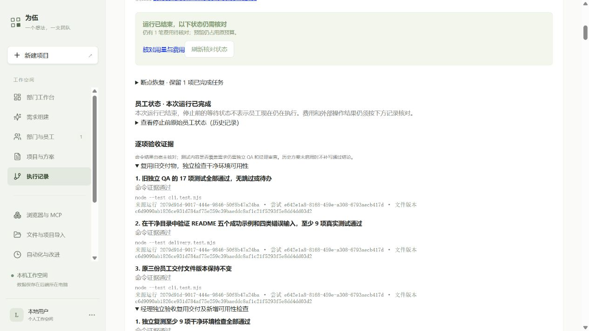
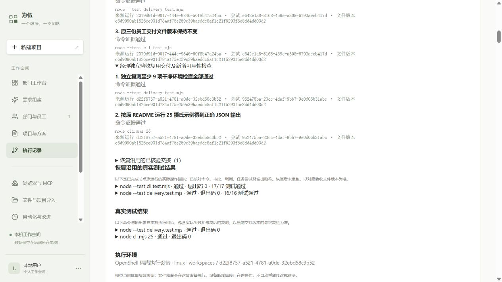

# JJ 交付验收闭环 · 2026-10-10

本轮通过：复用此前员工交付的小型温度换算 CLI，在 JJ 的真实 Go 模型与 OpenShell 环境中完成独立 QA、经理正式验收、网页受控恢复及交付下载验证。没有重新开发 CLI，也没有由 Codex 补写员工交付文件。

最终运行：`d22f8757-a521-4781-a0de-32ebd58c3b52`，方案 v14，`completed`，档案完整性 `ok`，经理 `verdict=pass`、无 findings，逐项命令证据 **5/5**。可在 [运行网页](http://127.0.0.1:4312/#run/d22f8757-a521-4781-a0de-32ebd58c3b52) 查看。

## 实际复用与验证

项目 `4ae5cce4-73c1-420a-987f-83db54d196f2`。原正常路径为 v11、运行 `6197cb6e-d63b-41e9-808e-3666bc376b84`；原代码、README、独立 QA 17 项测试及验收记录均保留。

| 文件 | 来源 | 本轮处理 |
| --- | --- | --- |
| `cli.mjs` | 原开发员工 | SHA256 保持一致 |
| `README.md` | 原开发员工 | SHA256 保持一致 |
| `cli.test.mjs` | 原独立 QA | 真实复测 17/17，无跳过/待办 |
| `delivery.test.mjs` | v13 的 QA 真实模型生成 | 干净目录复现 16/16；v14 直接复用，没有重写 |

完整哈希、输入绑定、命令、审批编号、操作编号、输出 SHA256 和员工来源见 [最终证据](evidence/delivery-2026-10-10/d22f8757-a521-4781-a0de-32ebd58c3b52.json)。交付包只有上述四份原始文件；网页下载与归档哈希全部一致，见 [下载核对](evidence/delivery-2026-10-10/web-proof.json)。

QA 新测试使用 Node 内置模块，在新临时目录只复制交付文件，直接启动真实 CLI。覆盖 README 的五个成功示例、四类错误输入、负数和小数、独立 cwd、退出码及清理边界。经理重新阅读文件并独立执行 `node --test delivery.test.mjs` 和 `node cli.mjs 25`，然后提交原生正式审查记录。

Windows 另做独立复现：原测试 17/17；只在副本中把公式偏移量 32 改为 31，测试发现 7 项失败；恢复副本后再次 17/17。原文件未改动。此项由 Codex 执行，属于独立测试有效性检查，不冒称新的员工验收或 OS 沙箱。见 [核对记录](evidence/delivery-2026-10-10/windows-proof.json)及 [失败原始输出](evidence/delivery-2026-10-10/windows-negative.txt)。

## 中断、失败和成功均保留

| 方案 | 运行 ID | 实际结果 |
| --- | --- | --- |
| v13 | `69766432-8165-457b-af86-01f1d2b61e72` | QA 17/17 + 16/16；经理等待审批时受控停止 |
| v13 恢复 | `6ac45960-b5b5-4f94-b465-fb50973877af` | QA 保留；经理复测通过，但提交 verdict 前达到 8 次调用上限，**失败** |
| v14 | `2079d91d-9017-444e-9846-50f8b47a24ba` | 四份文件直接复用，QA 复验完成；经理等待审批时受控停止 |
| v14 恢复 | `d22f8757-a521-4781-a0de-32ebd58c3b52` | **完成**；只运行经理，正式 verdict=pass |

v13 没有改账或伪造通过。它暴露了过低的调用数规划：摘要也计入次数，8 次不足以覆盖文件阅读、复测、恢复与正式审查。v14 用现有策略的每任务 40 次上限重新规划；历史版本的调用和费用仍保留。任务费用上限合计从 $0.30 降至 $0.20，项目上限仍为 $1.90。通用调用数估算仍需改进。

v14 停止前无在途模型费用、无结果未知的外部操作。服务 PID **408527 → 487347**，重启后恢复预检通过。网页实际完成“保留旧未知预留 → 检查恢复条件 → 恢复未完成任务 → 确认恢复”；旧审批取消，经理重新申请操作。父运行的 QA 完成节点、DAG、固定文件、宿主逐项证据与预算历史带入新运行。

恢复子运行只有 `delivery_review` 新交接，**QA 新模型调用为 0**；原 QA 测试也没有重放。经理自己的复测是独立审查的必要操作。见 [重启证据](evidence/delivery-2026-10-10/restart.json)和最终运行证据。

## 本轮修复

- 新增可选的“验收标准 → 批准命令 → 实际结果”映射；启用后全部标准须覆盖并通过。拒绝空测试、跳过、待办、失败和不完整统计。
- 正式批准快照显式保留映射；交接和恢复核对相同标准、attempt、规则哈希与文件版本。旧方案显示未定义映射，不补造新结论。
- 网页显示通过、失败、受阻、未验证，并在节点状态改变后更新证据。
- 修正工作区文件导入的权限校验：已有文件/终端员工可接收工作区文件；参考资料仍要求知识检索，共享文件仍须授予全部文件员工。没有新增员工权限。
- 保留超限失败，修正本轮调用数规划，不放宽执行门禁。

## 工程和网页验证

原生运行/交接相关测试 **26/26**，API/恢复/网页测试 **24/24**，资料导入集成 **3/3**，原资料集成 **1/1**；后续页面调整的相关检查通过。最终类型检查通过，Vite 构建通过（1701 模块，保留既有大包提示）。本地工程测试使用隔离夹具；真实员工验收使用 JJ 已配置模型，二者分开记录。

实际浏览器核对：五项命令证据通过、零失败/未验证；恢复入口及两次经理命令审批可操作；旧 QA 17/17、16/16 证据可展开；四份文件均可下载。Tabbit 本次路由不可用，使用可用的 Codex 内置浏览器完成。截图：

## 部署、费用与边界

JJ 发布位置 `/home/jj/.local/share/weiwu/releases/weiwu-acceptance3-20261010`；用户服务 `weiwu-jj.service`。旧发布、凭据、数据库与权限保留。部署前后 235 条用量一致，部署没有调用模型。固定依赖目录复用，不能直接删除旧发布中的依赖。见 [部署回执](evidence/delivery-2026-10-10/deployment.json)。

本轮真实模型调用 **38 次**，登记成本 **$0.2116158**。JJ 全部已登记成本 $1.2659562；当前项目累计 $1.2545772，旧未知预留 $0.0192111 未改为零，可用 $0.6262117。费用按配置单价和真实 Token 登记，供应方最终账单可能不同；没有提高原金额上限。见 [费用与证据汇总](evidence/delivery-2026-10-10/summary.json)。

本轮覆盖小型 CLI 交付验收，不代表所有长期研发任务均已验证。逐项命令成功仍需要独立员工审查语义覆盖；当前方案支持可选映射，并非所有历史或新方案都会自动启用。OpenShell 回执证明员工文件/命令在沙箱执行，模型协调与审批仍在后端。新测试的临时目录在测试结束时清理；全局临时文件与历史归档治理属于后续工作。

启动及网页操作见 [使用说明](../delivery-acceptance-quickstart.md)。完整原始测试输出与版本记录在 `docs/validation/evidence/delivery-2026-10-10/`；私有准备/重启原始档案仍保存在 JJ 的 `/home/jj/.local/share/weiwu/admin/acceptance1-20261010/` 和 `acceptance3-20261010/`。
