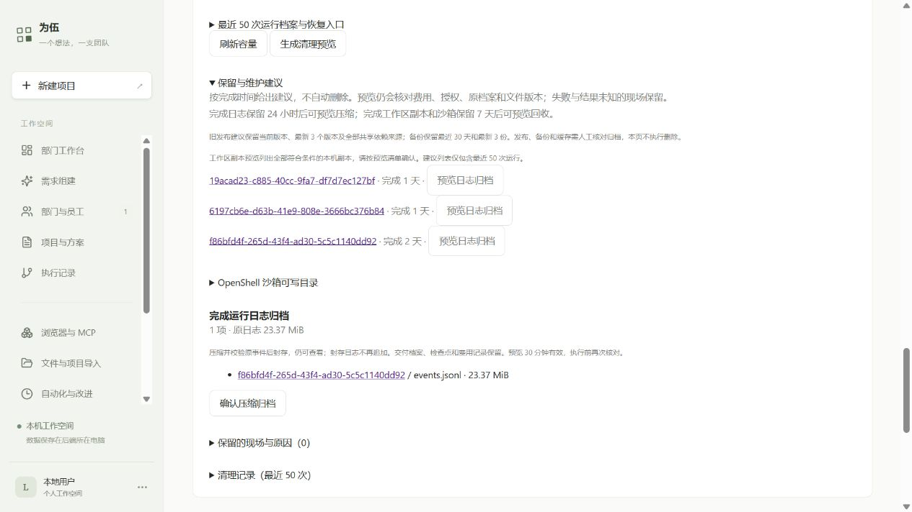

# 30 分钟沙箱耐久与网页保留建议验收

2026-10-11。在 JJ 的独立沙箱中，复用已有员工交付，验证读写、原测试、临时文件清理、已完成边界停机及新进程恢复。本轮不调用付费模型或员工，没有提高预算。生产环境仅增加只读建议入口和一次未确认的日志预览。

## 实际耐久结果

**通过**。北京时间 12:18:29 开始，实际运行约 30 分 3 秒；54 轮全部完成，原员工的 16 项测试每轮退出码均为 0。完成边界停止、新进程恢复和最后独立沙箱回收通过。[完整测量](evidence/endurance-retention-2026-10-11/physical.json) · [54 次采样](evidence/endurance-retention-2026-10-11/samples.jsonl) · [217 条操作收据](evidence/endurance-retention-2026-10-11/operations.jsonl) · [最后真实测试输出](evidence/endurance-retention-2026-10-11/last-test-output.txt)

| 实测项 | 结果 |
|---|---|
| systemd 独立单调时长 | 1,803,073.797 ms，同一 invocation 与 boot |
| /sandbox | 15,030～15,031 B，4 文件；原员工 3 文件 14,988 B，仪器标记增加 42～43 B |
| /tmp | 每轮清理后 0 B；每次明确创建 65,536 B 再清理 |
| 沙箱 cgroup 内存 | 27.43～32.70 MiB，观测峰值 58.39 MiB |
| worker RSS | 63.56～140.88 MiB；systemd 探针服务内存峰值 136.34 MiB，两者统计口径不同 |
| 仪器记录 | 全部普通文件 138,761 B（约 135.5 KiB）；采样 42,336 B，操作收据 83,196 B，其余为检查点、映射和最后输出 |
| 重复与结果 | 连续轮次 1～54；操作 ID 唯一；原沙箱已回收，未重放删除 |

工作目录没有持续增长；仪器日志随轮次增长，不能将本工作负载的增长率外推到任意员工任务。临时文件峰值是已知固定负载，目录统计是清理后的实际测量，不代表每种突发写入都受硬配额约束。

运行 `2326dc56-76c7-492b-8524-20f15b1d1ed1`，沙箱 `d2a640ed-2923-4a56-abc5-a762d8082927`。原员工运行 `f86bfd4f-265d-43f4-ad30-5c5c1140dd92` 的 `cli.mjs`、`cli.test.mjs`、`README.md` 逐字节复制；每次工具结果及最后读取都核对原文件。Codex 只写了显式标识的 `.endurance.json` 仪器文件，不改员工交付。

每轮读取原文件、按 SHA 条件更新仪器文件、运行 `node --test cli.test.mjs`、创建并删除 64 个 1 KiB 临时文件，再读取真实 /sandbox 与 /tmp 字节、cgroup 内存和 worker RSS。固定 OpenShell 0.1.2、1 CPU/512 MiB、无网络、单命令 60 秒及既有容量门禁均沿用。

中途在第 27 轮完成且持久保存后关闭第一个执行器，取得已停止回执；新进程从第 28 轮继续。PID `3552090` → `3689173`；原沙箱 ID、最后工作版本和来源版本一致，已经完成的轮次不重跑。工具意图在发送前 fsync，完整收据保存后才清除 started；结果未知或失败的检查点拒绝自动重放。最后核对原文件后只回收本次独立沙箱。

原始仪器资料保留在 `/home/jj/.local/share/weiwu/probes/endurance-5SBriK`；固定调用脚本在 `/home/jj/.local/share/weiwu/admin/endurance-retention-20261011`。公开证据只保留测量、ID、哈希和结果，不包含授权目录或凭据。

## 本轮修复及工程检查

独立审查发现的两项 Important 已各自 RED→GREEN 修复：

1. 墙钟前跳可能提前通过耐久判定：改为各 worker 的单调计时，以及 controller 的独立单调时长门禁。当前物理测试保持启动时的脚本，不在运行中覆盖；真实时长另外由 systemd 单调时间证明。一次性服务完成后已卸载，从同一 invocation/boot 的官方启动、资源结算日志核对实际 30 分 3 秒。最初提取器误以为 stdout 在 journal，实际写独立文件；修正来源后全量核对通过，没有重跑外部操作。修复后的计时判定在 Windows、JJ Linux 回归通过；没有把单元测试当作另一条 30 分钟物理路径。[版本来源](evidence/endurance-retention-2026-10-11/source-provenance.json)
2. 数据库完成但原档案未知/损坏时仍给维护建议：复用原 `readRun` 完整性、终态与 unresolved 操作检查，读取异常保留现场。预览和确认继续执行原有费用、设备、空闲、版本与文件保护。

| 范围 | 结果 / 原始输出 |
|---|---|
| 沙箱、档案、保留核心及计时修复 | [61/61](evidence/endurance-retention-2026-10-11/core-final.txt) |
| 隔离维护 API | [21/21](evidence/endurance-retention-2026-10-11/api-final.txt) |
| 加密备份、隔离恢复、旧备份兼容 | [3/3](evidence/endurance-retention-2026-10-11/backup-final.txt) |
| 网页建议与原确认视图 | [8/8](evidence/endurance-retention-2026-10-11/ui-final.txt) |
| JJ Linux 部署前回归 | [55/55](evidence/endurance-retention-2026-10-11/jj-deployment.txt) |
| JJ 修复后计时判定 | [6/6](evidence/endurance-retention-2026-10-11/jj-clock-final.txt) |
| TypeScript / Vite | 退出码 0；[类型](evidence/endurance-retention-2026-10-11/types-final.txt)、[构建](evidence/endurance-retention-2026-10-11/build-final.txt) |

PGlite 为单产品连接，协议模型使用测试替身；物理沙箱只运行原员工测试和固定仪器。未重跑依赖独立 PostgreSQL 的全仓测试，不宣称真实模型长任务或独立数据库锁竞争已在本轮验证。Vite 既有 >500 kB 包警告保留。一次补充备份命令误用不存在的旧路径，API 部分已通过；改用实际 `extensions-backup.test.ts` 后 3/3 通过。

## 网页与数据保护

当前 JJ 发布 `/home/jj/.local/share/weiwu/releases/weiwu-retention1-20261011`，服务 `weiwu-jj.service`，PID `3704365`；保留前一发布及固定共享依赖。[部署回执](evidence/endurance-retention-2026-10-11/deployment.json)

打开 [JJ 设置页](http://127.0.0.1:4312/#settings)，展开“文件与数据容量 → 保留与维护建议”。完成日志 24 小时、完成副本和沙箱 7 天后给建议；失败、费用未知、档案损坏或未知操作不进入建议。按钮复用既有预览，确认前不删除。工作区按钮预览全部符合原规则的本机副本，不是单行清理。

网页实际生成原员工运行的日志预览 `654fead3-87a8-4f23-89f4-7b8689cf51b6`，原日志 23.37 MiB；生产确认未点击。[API 只读及预览证据](evidence/endurance-retention-2026-10-11/live-retention.json)

旧发布建议保护当前版本、最新 3 个版本及全部共享依赖来源；备份建议保护最近 30 天和最新 3 份。这些是维护建议，不是自动到期删除规则。实测前 `du -sk`：旧发布 2437284 KiB（22 个）、缓存 331592 KiB、备份 845736 KiB、探针 9264 KiB；范围可能包含共享资料，不能与网页表直接相加。旧发布可能供后续版本链接引用依赖，不能按日期直接删。

## 边界与选择

本轮选择只读建议与原确认动作，没有自动清理：代价是旧发布、备份和缓存仍需人工核对归档。尚未验证多小时员工自主任务、模型上下文增长、所有临时文件类型或硬磁盘配额。30 分钟的固定文件/测试工作负载不能证明 7×24 小时任意开发任务可靠。

最终核对原 6 个项目状态与版本、362 条用量及 332 个档案文件（366,882,161 B）全部一致；正常与恢复路径仍为 completed / integrity ok。来源 3 个员工文件与原档案逐项 SHA 一致，公开物理证据哈希也已核对。生产文件删除 0、生产日志归档 0、模型和员工调用 0。[保护核对](evidence/endurance-retention-2026-10-11/preservation.json)

原预算合计 $1.934692（含未知预留）、原 $2 授权不变，剩余 $0.065308。没有将未知费用按零结算。本轮选择不替换正在运行的探针，以独立单调证据证明时长；代价是修复后的计时实现没有再次跑完整 30 分钟，只有 Windows/JJ 回归。探针固定在既有 JJ 发布及配置，实际脚本、执行库字节与来源核对通过；不能据此认证任意其他机器或配置。独立审查没有未处理的 Minor。
