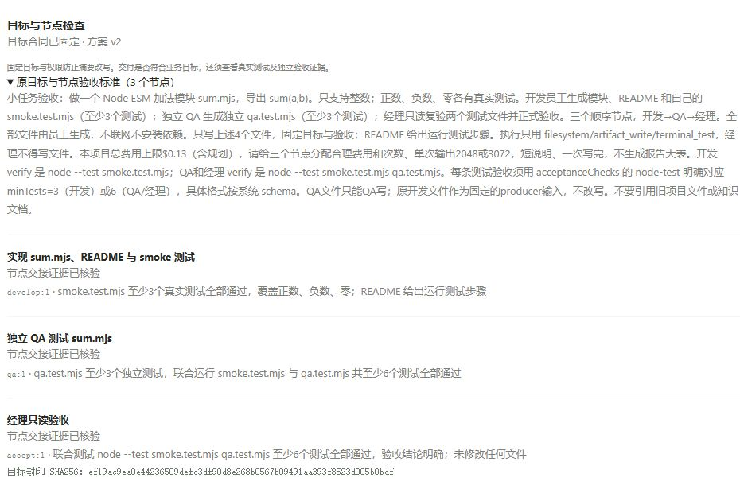
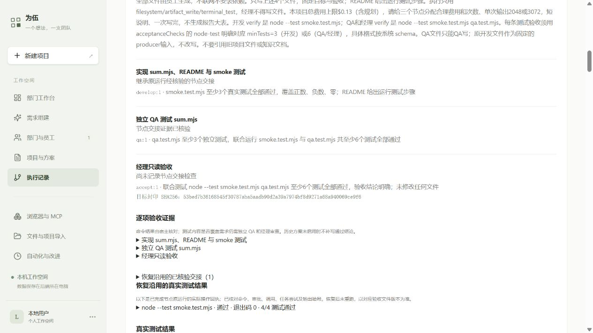

# 目标固定、节点检查与暂停验收

最新状态（2026-10-11）：预算补充经用户授权、由真实 AI 分配后，恢复项目已获得经理正式验收，9/9 测试通过。最终运行 `5bbc46e2-8dc5-496c-acca-b2abc8c282b8`；累计费用及预留 $1.9346919，仍在 $2 内。下方失败与受阻段落为先前阶段的原记录；最终证据及当前使用方法见 [恢复验收补充报告](resource-resume-2026-10-11.md)。

本轮在现有 DSH AgentTeams、文件合同、HandoffGate、ReworkGate 和监督器上补目标封印，没有增加依赖或每回合目标评判模型。新批准运行固定原需求、方案版本、任务验收与文件范围、员工权限、策略和模型配置；请求、工具准入、交接及恢复使用同一封印。原验收始终来自批准快照，摘要、知识资料及恢复记录不能替代它。

## 已修复

1. 批准合同被修改或重新封印时，宿主独立副本能拒绝继续请求并保留暂停原因。
2. 恢复预检和实际恢复共用校验，同时核对数据库行与原档案；越界暂停要求重新批准方案。
3. 排队的外部工具取得执行名额后重新检查目标，暂停后不会继续派发。独立审查复现此竞态，新增测试从“未拒绝”变为通过。
4. shell 执行后发现越界改文件，也会暂停后续准入；原先只有交接失败。实际临时目录用例从“没有 goal/blocked”变为通过。
5. 网页集中展示固定目标、节点验收编号、交接记录、继承结果与暂停原因。旧运行明确标记未启用，未伪补通过记录。

## 工程证据

| 检查 | 实际结果 |
| --- | --- |
| 相关原生宿主/工具/返工/监督/交接/结算回归 | 48/48，通过；模型为替身，命令在真实临时目录执行 |
| 封印、网页与恢复确认纯测试 | 16/16，通过 |
| 隔离恢复 API | 9/9，通过；目标改写和边界暂停均拒绝创建子运行，零模型请求 |
| 隔离完整主流程 API | 18/18，通过；覆盖正常、摘要、合法返工、两次中断恢复、未知操作不重放 |
| 批准门禁/导入文件回归 | 4/4、3/3，通过 |
| TypeScript / Vite | 通过；仍有已有的前端包大于 500 kB 提示 |
| 普通项目全测试（串行） | 653 项：360 通过、186 失败、107 跳过，未全绿；本机缺少 127.0.0.1:55432 的 PostgreSQL。失败名称见附录 |

原本机执行 API 三个失败由相对 `NODE_OPTIONS` preload 随子命令切换目录造成；改用绝对 `file:///` 测试路径后 D1 四项及完整主流程通过，没有放宽产品门禁。Windows 临时目录清理曾遇到 ENOTEMPTY；采用标准 fs.rm 的有界重试后相关回归通过。

命令：`node --import tsx --test tests/goal-contract.test.ts tests/run-goal-checks.test.ts tests/run-recovery-confirmation.test.ts`；`node --test --test-concurrency=1 services/agent-runtime/{product-tools,product-concurrency,run-evidence-native,rework,supervisor,acceptance-checks,handoff,delivery-settlement}.test.mjs`（实际使用逐个路径）；`node scripts/test-integration.mjs tests/recovery-conditions.test.ts tests/product-flow.test.ts`；`tsc --noEmit`；`vite build`。长输出保存在本阶段工作记录，下面是真实模型验收，不能由这些替身测试替代。

## 真实正常路径

- 模型：现有 OpenCode Go 的 `deepseek-v4.1-flash`；原 OpenShell v0.1.2 固定 Node 24.19 镜像、原设备及授权。
- AI 方案预览：`0dbd4d81-7f45-497b-af5f-8b210148476e`，确认后项目 `d3633183-19b5-4852-940b-f34758ebe8fd` v2。
- 运行：`213d33c2-3aac-4122-bccf-2520c2c61b0e`，开发 → 独立 QA → 经理，正式完成。
- 开发生成 sum.mjs、README 和 smoke 测试；QA 生成独立 qa.test.mjs。经理只读复验并正式 pass；所有业务文件由员工生成，证据目录仅复制原文件并核对 SHA256。
- OpenShell 实际测试：开发 7/7；QA 联合 13/13；经理独立复验 13/13。三节点都有 goal/node-checked 和正式交接。
- 执行 21 次真实模型调用，费用 $0.0890433，另有 AI 规划费用，全部在项目 $0.13 内。测试审批由 Codex 在用户授权的小任务范围内代操作，只批准原 verify 中的固定 Node 命令。
- 复制的交付包又在 Windows Node 24.19 上执行原 QA 测试：13/13；没有补写或修正员工产物。

[原始交付文件与证据](goal-check-evidence-2026-10-10/normal/proof.json)，[Windows 测试输出](goal-check-evidence-2026-10-10/normal/windows-delivery-test.txt)。

## 真实服务重启恢复

复用上一份真实 AI 方案，另建项目 `1d432498-6e6a-4da5-9833-4e946283f29b` v2，上限仍为 $0.13。这次方案来源是复用，API 标为手动保存，未冒称又一次 AI 生成。

原运行 `3d004ea7-bb65-48bc-9513-1b0511fd469f` 在开发正式交接、QA 写出独立测试并等待测试审批时受控重启。重启前核对无在途模型费用、无结果未知操作、所有已派发本机操作都有完成回执，且只有该项目活跃。服务 PID 1459188 → 1547958；正常关闭使原运行进入 cancelled。目标封印前后均为 `53bed7b36168545f30787aba5aadb90d2a39a7974bf8d9271a68a940069ce9f6`。

官方预检通过后恢复为 `8b8dff91-7a2f-4ba7-a079-792d2f06ff7c`，继承开发完成节点及整个 DAG，原费用和调用计数继续计入。重启前四个文件的 SHA256 均与恢复工作现场一致，QA 未完成文件也保留。后续结果与调用核对见 [恢复证据](goal-check-evidence-2026-10-10/restart/proof.json)、[原运行证据](goal-check-evidence-2026-10-10/restart-parent/proof.json)、[服务重启记录](goal-check-evidence-2026-10-10/restart-proof.json)。完成状态和最终账本在本节下方补充；未完成前不标记验收通过。

**已验证：**子运行没有 develop 的模型请求或文件重写，QA 新增4次调用，联合测试9/9并完成正式交接；经理实际复验9/9。原目标封印与四个文件 SHA256 前后完全一致。

**受阻：**经理最后一次模型调用在北京时间 2026-10-10 22:27:15～22:27:17 连接失败，未取得用量；没有经理正式 accepted，子运行状态 failed，完整恢复路径尚未验收通过。收据 `730e094b-e047-4b11-a159-8dffa4a83d40` 保留 $0.0352938。自动单请求账单查询返回 HTTP404（New API接口不支持），停止反复查询。恢复预检以 COST_PENDING 拒绝新子运行，没有重放未知请求或清空原计数。

按用户后续要求，又做一次“回复 OK、最多16输出Token”的真实连接测试，仍为 GATEWAY_CONNECTION_FAILED，没有中转站 HTTP 响应；收据 `f865392a-f575-4f5b-9041-59954d407986` 保留 $0.0003711。JJ 的 curl 和同版本 Node 对不带 Key 的 HEAD 请求均收到 HTTP404，DNS/TLS/基本连接正常；这个结果不能判断是否余额不足。账户限额、Key状态和服务端异常仍需供应商证据。未修改代理、证书或凭据。

截至北京时间 22:37 的账本：已知 $1.8577596，未知预留共 $0.054876（包括原有 $0.0192111），合计 $1.9126356，仍低于原累计 $2 授权，剩余 $0.0873644。原项目两个 $0.13 上限没有提高。不能靠重试重置预算。

工程完整输出：[原生运行回归](goal-check-evidence-2026-10-10/engineering-runtime.txt)、[纯逻辑与网页回归](goal-check-evidence-2026-10-10/engineering-pure-ui.txt)、[隔离API](goal-check-evidence-2026-10-10/engineering-api.txt)、[构建](goal-check-evidence-2026-10-10/engineering-build.txt)、[普通全测试失败名称](goal-check-evidence-2026-10-10/project-suite-failures.txt)、[最小连接测试](goal-check-evidence-2026-10-10/connectivity-proof.json)。

## 后续生成恢复与预算门禁核验

用户要求继续后，北京时间 2026-10-10 23:54 的真实文本测试成功，返回用量；最多16输出Token的测试新增账本费用 $0.0000036。没有更换 Key、修改代理或提高预算。此前两次连接失败的原因仍没有供应商结论，不能由本次成功倒推其未扣费。

更正此前恢复受阻表述：现有产品允许明确选择“保留未知费用预留，在原预算继续”。费用未核对并非绝对不能恢复；预留继续占用额度，结果未知的修改操作仍须单独核对。这次实际检查未知外部操作为0，保留旧预留的官方预检通过后，创建子运行 `52c502e5-e8dd-42a8-b1b8-d3813029b128`，未确认或重放任何未知修改操作。

子运行继承 develop、qa 两个完成节点，原目标封印和四份员工文件 SHA256 完全一致。后续在派发模型前因 `BUDGET_CONTEXT_LIMIT` 停止：项目净预算 $0.004078，完整受保护请求最低预留 $0.0115479，缺口 $0.0074699。经理原调用额度仅余1次；不能把这一最低单请求缺口当成整个后续验收的费用上限。

**本次子运行新增模型请求0次、费用0、测试操作0；没有经理正式验收。完整恢复验收仍未通过，当前阻塞是本地已批准项目预算，并非已证明的 API Key 失效。** 预检的 `nativeRequestChecked=false` 也表明它没有证明动态原生请求必然能装入预算。

当前累计已知 $1.8577632，旧未知预留 $0.054876，总占用 $1.9126392，距原 $2 上限尚余 $0.0873608。没有清零旧费用或调用计数，没有重复尝试同一预算不足路径。下一步安排见[预算分配提案](goal-check-continuation-budget-2026-10-11.md)。

证据：[生成与恢复结果](goal-check-evidence-2026-10-10/continuation-proof.json)、[本次子运行封印、完成节点与文件清单](goal-check-evidence-2026-10-10/restart-continuation/proof.json)。这些是实际 API 回执和原文件的只读复制，不是员工补写的交付物。

## 使用方式及限制

JJ 已部署 `/home/jj/.local/share/weiwu/releases/weiwu-goalcheck1-20261010`。Windows 浏览器访问 `http://127.0.0.1:4312/`（SSH 转发 JJ 4310）；已有连接、模型及权限沿用原配置。网页确认方案并批准执行后，运行页显示目标与阶段检查、逐项测试、审批和下载文件。正常中断使用恢复条件检查、确认恢复未完成任务；目标或权限边界违规需返回项目重新制定并批准方案。

这层证明批准合同未被改写和交接有真实证据，不能证明任意语义目标都正确。任意 shell 文件越界目前在命令结束后审计，操作前隔离由现有 OpenShell/工具权限承担。此次实测是短任务和正常关闭的受控服务重启，未测试断电或 SIGKILL，也不等于任意长任务永不偏离。

独立审查未发现剩余 Critical/Important；两项 Important 修复有 RED→GREEN 回归。一个 Minor 暂缓：发生后来返工时，目标卡仍显示历史已核验交接；当前任务状态图才是当前状态，后续需明确历史标签。知识提速、持续任务队列和自动经验晋升仍未在本轮实现。

工程选择：沿用已批准范围及现有工作树；使用封印和现有独立验收，避免额外循环评判调用；测试环境使用绝对 preload 路径；部署及实测结论由实际回执支持，独立审查没有代替这些验收。若选错，影响分别是范围偏差、语义误判、测试环境失真或发布质量被高估，因此保留明确边界及失败记录。
