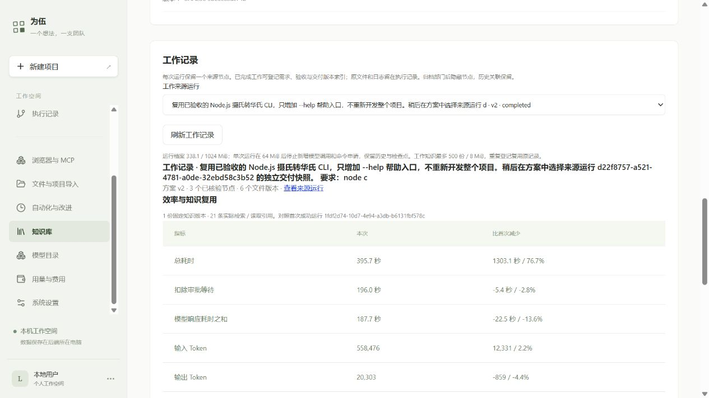

# 知识复用量化记录 · 2026-10-10

已经完成一组真实同任务对照，并把结果登记到部门知识库。**本次总 Token 和费用略减，扣除审批等待后并未加速。** 不把人审更快或模型的随机差异归因于知识复用。

## 两次运行与控制条件

| 项目 | 首次 | 复用部门知识后 |
|---|---|---|
| 项目 ID | `591c8468-febf-4d71-9414-2ee3b987f671` | `cf00d8a8-078b-43ae-847b-fb8607a23575` |
| 运行 ID | `1fdf2d74-10d7-4e94-a3db-b6131fbf578c` | `5825ba34-8451-4cf5-a30e-30454e699948` |
| 方案 | 首次真实 AI v3 | 沿用同一 AI 方案；追加只读知识授权和检索指令，保存为 v2 |
| 结果 | 完成，经理正式 pass | 完成，经理正式 pass |
| 公司/部门知识 | 0 文档、0 引用 | 固定 1 文档 v1；开发、QA、经理均实际检索和读取 |

需求都是在旧摄氏转华氏 CLI 中增加唯一参数 `--help`，不改原换算与错误行为。原始工作区都使用快照 `9ee5cc2f-4758-4ea2-89c8-e3bf1c6f4a25` 的同三份文件；都不直接导入已经实现帮助功能的新 CLI。三人职责、验收标准、DeepSeek V4.1 Flash 配置、输出上限、OpenShell 设备和镜像一致。需求、验收、模型、设备和初始工作区五个哈希均相同，见 [机器数据](evidence/userflow-2026-10-10/reuse-record.json)。

知识来源 `work-1fdf2d74-10d7-4e94-a3db-b6131fbf578c` v1，SHA256 `3be6ce3ac74b41a91813d086c37b4a8795176461506fb120b16080b635cb6434`。知识只记录首次需求、验收、命令、交付版本及实测，没有把通过结论当成本轮证据。第二次 QA 实际重新生成测试、执行原 17 项和新增 4 项，经理再次独立执行 17+4 并正式验收；旧 `cli.test.mjs` 原 SHA 保持。

## 执行阶段实测

减少量 = 首次 − 本次；负值表示增加。百分比的分母为首次值。需求对话和规划另记，不混入这张执行表。

| 指标 | 首次 | 知识复用后 | 变化 |
|---|---:|---:|---:|
| 总耗时 | 1698.783 秒 | 395.661 秒 | 减少 76.71% |
| 审批等待（重叠去重） | 1508.186 秒 | 199.634 秒 | 主要等待差异 |
| 扣除审批等待后耗时 | 190.597 秒 | 196.027 秒 | **增加 5.430 秒 / 2.85%** |
| 模型响应耗时之和 | 165.174 秒 | 187.663 秒 | **增加 22.489 秒 / 13.62%** |
| 输入 Token | 570807 | 558476 | 减少 12331 / 2.16% |
| 输出 Token | 19444 | 20303 | **增加 859 / 4.42%** |
| 总 Token | 590251 | 578779 | 减少 11472 / **1.94%** |
| 实际模型发送次数 | 31 | 30 | 减少 1 / 3.23% |
| 登记费用 | $0.1945749 | $0.1919064 | 减少 $0.0026685 / **1.37%** |

首次项目包含两轮需求与三次规划，总费用 $0.2158935；第二次直接复用既有 AI 方案，没有新增规划调用。两者总流程规划步骤不同，因此不拿项目总费用差作知识复用收益。价格来自已配置模型费率和返回用量，属于产品登记费用，不是供应方独立账单或订阅真实边际成本。

这是一次实测、不是统计显著或因果实验。首次发布为 userflow4，第二次为 userflow6；新增知识工具和指令也是处理条件的一部分。模型输出、QA 实现、缓存和响应时间会波动。总耗时的大幅减少主要来自审批更及时，不能说“知识让 AI 快了 76.71%”。引用证明检索/读取发生，不能单凭引用证明采用效果。下一次同条件复用仍自动对照首次完整成功运行，记录正负结果。

## 数据保存与保护

网页入口：“知识库 → 工作记录 → 选择运行 → 效率与知识复用”。两次结果分别保存为知识文档 `work-<runId>` v1；重复登记复用原文档，历史不覆盖。记录包含原始数值、对照运行 ID、版本/引用和方法说明。

有未结清费用、缺失实际发送回执、不同任务/标准/模型/设备/初始工作区时不计算节省。恢复分段只显示本段数据，防止把跳过前序节点误认为效率提升。备用模型按每笔实际发送及其 settled/released 收据核对，未知费用不按零。没有足够模型耗时记录时显示未知。

原始员工输出在 [首次证据](evidence/userflow-2026-10-10/proof.json)与[复用证据](evidence/userflow-2026-10-10/reused/proof.json)，测试日志是实际工具结果与封存 SHA 匹配的字节；开发语法检查原输出为空，其他测试输出均完整保留。全量 trace 留在 JJ 私有运行目录，没有放入 Git。

累计已登记费用 $1.6737561，旧未知预留 $0.0192111 保留，合计 $1.6929672，未超过原 $2 测试授权。见 [最终预算](evidence/userflow-2026-10-10/final-budget.json)。

