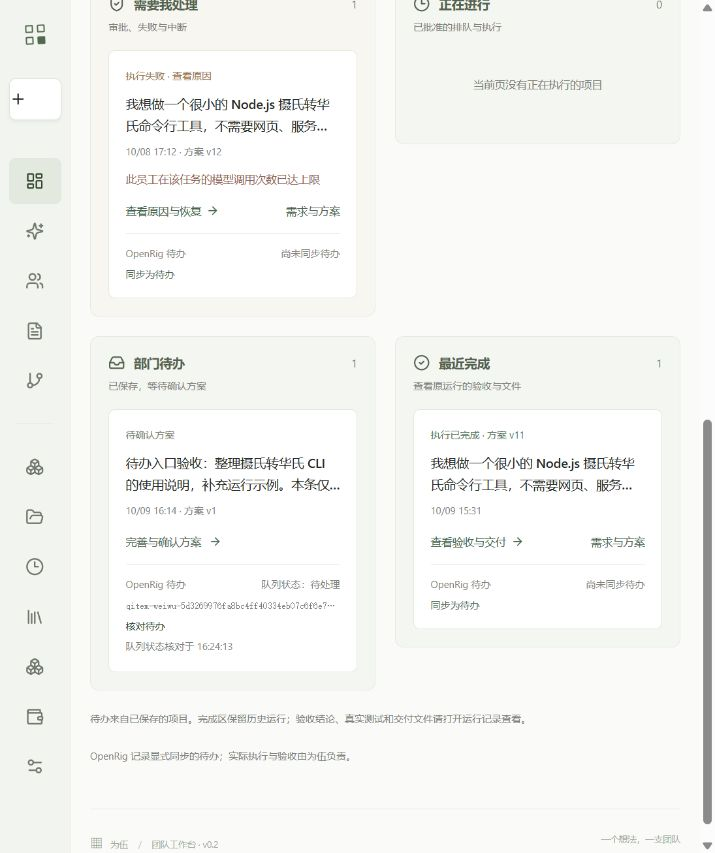
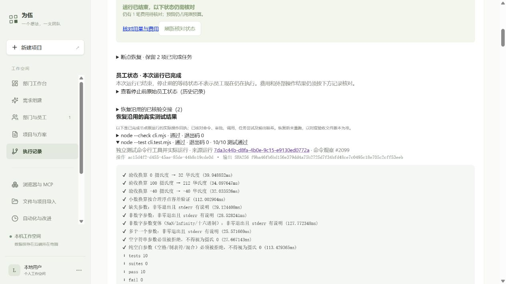

# 为伍阶段 1–2 交付与验收

本轮落实可运行版本和部门工作台。JJ 已运行真实 OpenShell 员工流程；网页支持查看部门待办、执行、待处理和交付，并可把待办同步到官方 OpenRig。持续自动接单、容量治理和完整 Eval 平台属于后续阶段。

使用入口：[JJ 网页使用说明](../deployment-jj-quickstart-2026-10-09.md)。Windows 通过 `scripts/deployment/connect-jj.ps1` 连接，默认打开 `http://127.0.0.1:4312/`。数据保留在 JJ，关闭浏览器不终止 JJ 服务。

## 实际验收

| 项目 | 已取得的证据 |
| --- | --- |
| 正常执行 | v11 运行 `6197cb6e-d63b-41e9-808e-3666bc376b84`：员工生成 CLI 与 README，独立 QA 生成测试并真实执行 **17/17 通过**，经理正式验收；独立审计 **22/22** |
| 中断与重启 | v12 父运行 `15c79ce8-58cc-48df-93e6-11b8f54d21f3` 经网页停止，服务 PID 确实改变；DAG、文件、费用、调用、凭据保持 |
| 恢复 QA | 子运行 `7da3c44b-d8fa-4b0e-9c15-e9130ed0772a` 保留 T1，独立 QA 真实执行 **10/10 通过**；随后因完成后额外调用达到原限额而失败，原失败记录保留 |
| 恢复经理 | 修复收尾后，新运行 `19acad23-c885-40cc-9fa7-df7d7ec127bf` 保留 T1/T2，只执行 T3；3 次真实模型调用，3 次文件只读，正式交接和质量复审通过；已完成员工不追加请求，协调者另有一次未出站即取消的收尾尝试，无新增费用 |
| 知识版本 | 恢复前目录从 v2 更新到 v3；恢复后的 QA 实际检索、读取已批准的 v2，保留引用来源及内容哈希 |
| 部门工作台 | 浏览器实际保存新需求为待办，显示四类工作入口、失败恢复、历史交付；没有自动批准该新待办的规划或执行 |
| OpenRig | 官方实例接收新待办 `c547e45b-393a-4848-b707-defa6005a26f`；刷新及核对仍是唯一 qitem；真实数据库恰好 1 条，待办仍 DRAFT、0 运行、0 费用 |
| 数据恢复 | 最终发布备份 **1,575 个文件**，实际隔离恢复 205 条用量、16 个运行、2 个项目和唯一 OpenRig 工作项；包含最终经理验收与三份交付文件，原环境保留 |
| 工程验证 | JJ4 的 **126/126 Linux 回归**、类型检查、构建、启动自检通过；证据展示修复 **44 项回归**，最后 SQL 类型修复在生产一致的 TEXT 表结构下 **5/5 API 测试通过** |
| 最终网页 | 实际显示经理验收、恢复沿用的两项已核验交接、原 QA **10/10** 结果与来源；直接 HTTP 接口返回 verified，截图已保存 |

业务交付的 `cli.mjs`、`cli.test.mjs` 和 `README.md` 由项目员工生成。Codex 修改的是为伍软件及部署、验证工具，没有补写员工交付物。正常路径和恢复路径是两个批准版本，分别保存自己的测试与文件版本，不能把 17 项和 10 项当成同一测试集。

## 费用与原数据

最终经理续跑新增 **$0.0197034**。项目已登记 **$1.0429614**，旧未知费用预留 **$0.0192111** 继续占用额度；项目上限仍为 **$1.90**，本轮 JJ 累计授权仍为 **$2**。未知收据没有按零清除，已完成任务的调用计数没有重置。实际账单以网页明细为准。

发布保留了原版本、历史失败、原始数据和凭据。恢复副本位于独立私有目录，未覆盖生产环境。公开验收材料只保存必要身份、统计、哈希及脱敏结果，备份正文和密钥留在 JJ。

## 本轮修复

1. 将 OpenShell 真正接入员工文件与命令执行，补齐设备授权、版本约束、启动适配和操作回执。
2. 修复员工正式完成后仍追加模型调用的问题，使用现有 Harness 的 `concludeTurn()` 结束当前回合；不提高任务限额。
3. 修复费用自动刷新取消恢复确认面板的问题；确认内容保留，条件不满足时禁用提交。
4. 增加部门工作台和现有部门接收新需求的入口；新需求先成为待办。
5. 接入官方 OpenRig 的岗位与工作项元数据，保存唯一映射，回执未知时先核对，保留为伍的唯一执行和验收权限。
6. 修复多级恢复时遗漏祖先交接与 QA 测试展示，逐代核对文件、尝试和原始回执；修正操作 ID 的生产 TEXT 查询类型，保留首次真实 API 检查失败记录。

## 使用现成能力的边界

- DSH 继续负责员工 Host、会话与工具执行循环，完成回合复用其官方接口。
- OpenShell 负责 Linux 沙箱隔离，为伍适配授权、工作区版本、审批及回执；Windows 网页可访问 JJ，无需把用户端迁移为 Linux。
- OpenRig 目前负责可选的岗位和队列元数据。它没有第二套模型 Key、员工会话或执行调度。
- 备份继续使用现有数据库能力、SQLite backup 和文件归档；实际验证放在隔离目录。

## 限制与后续

**已知未实现**：OpenRig 自动领取和终态关闭、多版本替换、部门持续自主调度、沙箱/临时文件自动回收、完整经验审核与 Eval 体系。服务可以保活，不代表已经验收连续 24 小时无人值守。

**未验证**：连续 24 小时运行、休眠断电、跨机器完整迁移。部门页面的知识权限正反样例尚未形成完整配对，不能用两个无权限员工的查询来声称已证明授权成功。常驻 OpenRig 已在真实 qitem 创建后实际重启，同一条记录、内容及映射保持。

**保留失败**：首次恢复子运行的调用限额失败、此前部署预检拒绝和历史未知费用均可追溯。正常 v11 的协调经理原始总结与正式验收记录存在表述差异，以正式交接、文件和测试回执判定，原始回复保留。恢复经理报告的一处测试范围描述不够准确，QA 原始命令和 10 项结果才是测试证据。

**维护边界**：网页加密备份尚未包含可选 OpenRig SQLite/config/token；机器完整迁移需另备这部分。当前 OpenShell 沙箱停止/销毁与自动 TTL 回收没有形成完整产品入口。生产数据和旧发布仍保留，不为节省空间擅自删除。

下一阶段先补工作项生命周期、显式调度和资源回收，再引入监管/Eval 与审核后的经验沉淀。每项仍先选成熟组件，通过薄适配接入现有预算、授权和证据链。

## 证据索引

- [阶段进度及失败经过](phase1-phase2-progress-2026-10-09.md)
- [OpenShell 正常路径](openshell-real-normal-v11-2026-10-09.md)
- [OpenShell 受控重启与最终恢复，19/19 审计](openshell-real-recovery-v12-2026-10-09.md)
- [首次恢复失败与真实 QA 结果](openshell-recovery-v12-first-resume-failure-2026-10-09.md)
- [完成回合修复](completed-turn-boundary-fix-2026-10-09.md)
- [恢复确认交互修复](recovery-confirmation-refresh-fix-2026-10-09.md)
- [JJ3 发布、105 项检查与 1,558 文件恢复](jj3-release-2026-10-09.md)
- [最终 JJ4 发布、126 项检查与 1,575 文件恢复](jj4-release-2026-10-09.md)
- [多级恢复证据展示修复](run-lineage-evidence-fix-2026-10-09.md)
- [生产 SQL 类型修复及真实接口验证](run-lineage-sql-hotfix-live-2026-10-09.md)
- [OpenRig 网页同步及真实 qitem 隔离恢复](jj-openrig-web-sync-audit-2026-10-09.md)

Git 交付范围为本轮审阅代码、说明和脱敏验收材料。历史未追踪验证资料与私有 `.data` 原样保留，不批量加入 Git；密钥、数据库和备份正文不在提交中。
