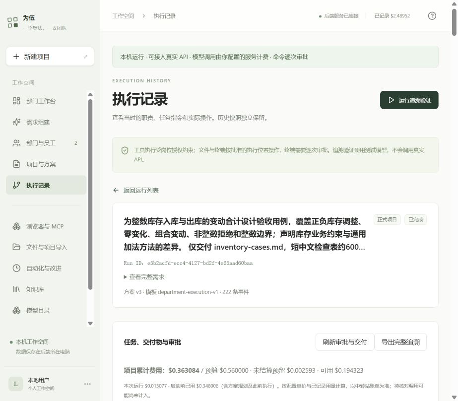
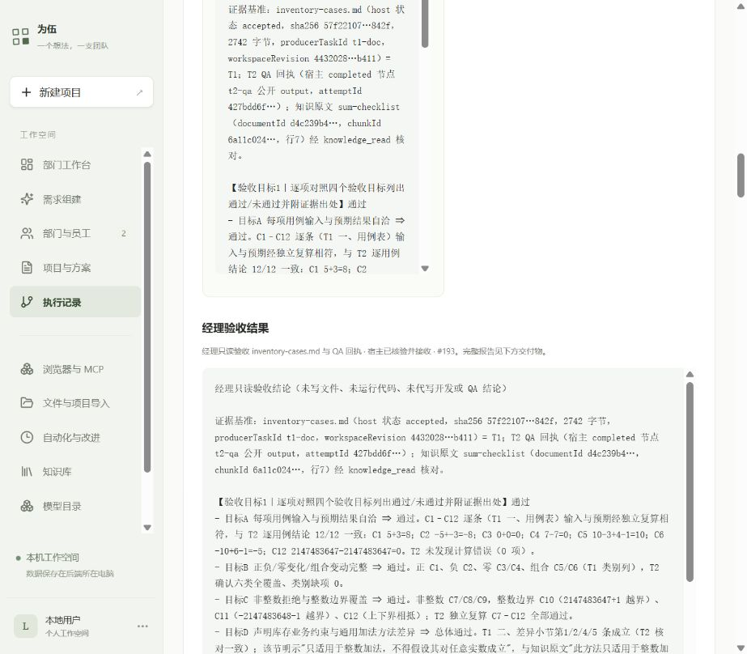
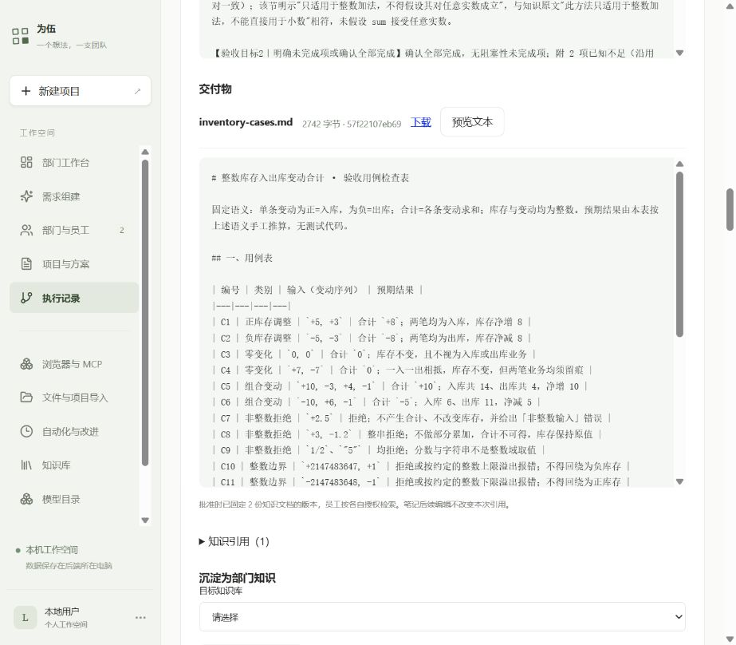

# 库存文档原项目真实续验

日期：2026-10-15。用户在核算后明确回复「可以，你进行动态的调整吧，要求就是这次一定要把这个续验完成」。本轮依据此授权在原累计$2.80、阶段$0.72、项目$0.56内推进，不扩权限、不清零历史、不手写员工结论。

**最终结果：本次原库存文档项目的QA→经理续验已完成。** 最终运行`e5b2acfd-ecc4-4127-bd2f-4e65aad60baa`为completed/integrity ok，真实经理verdict pass；开发与QA不重跑，原文件与知识版本保留。网页实测结果与交付预览通过。本轮全部尝试新增登记$0.0767064，累计占用$2.5632984/$2.80。[最终审计](evidence/recovery-full-dynamic3-2026-10-15/final-audit.json)。下文保留全部失败和调整过程，范围仅为这一只读文档任务。

## 第一段：QA已正式完成，总次数耗尽

- 来源 `b03ac2e1-0086-4fe7-9b6b-eca98d8e5fbf`。
- 真实候选 `9b61275e-b5cf-4440-8f71-b755087e1acc`，规划收据 `5631ab7c-5cc9-4c31-9349-052850dfa170`，$0.000609。
- 新运行 `5327ddc6-a15d-40b6-a85c-7fa69dd49176`，完整性ok，最终failed / TURN_LIMIT。
- QA新增4次，经理新增4次，团队协调新增4次，共12次执行；126636输入、8561输出Token，执行$0.048264。
- 规划加执行$0.048873；原开发文件SHA不变，旧未知预留$0.0025932保留。

QA于seq354正式封存，原文件SHA、输入版本、完整核算回执及已用预算一并记录。真实QA逐条核算12个用例并确认六类覆盖，同时指出差异声明1处不精确、边界拒绝描述1处歧义；不将这些问题改写为“交付毫无限制”。[员工真实交接与报告](evidence/recovery-full-real-2026-10-15/qa-handoff.json)

经理已认领、读取交付、团队QA回执及固定知识，工具均成功；尚未正式提交时项目累计达到75次。此处是总次数门禁，不是模型输出截断或资料访问失败。第一段完整结果、用途与费用：[status](evidence/recovery-full-real-2026-10-15/status.json)、[逐次归属](evidence/recovery-full-real-2026-10-15/wire-attribution.json)。

原核算覆盖了两个员工的12次，但遗漏为团队协调单独留下次数；原联合测试曾出现未归属调用，上一段没有出现不代表下一段不会出现。这是本次安排的遗漏，不把它归咎于用户预算不足。

## 动态调整1：只继续经理并预留协调

已完成开发与QA保持，来源切换到最新运行 `5327ddc6-a15d-40b6-a85c-7fa69dd49176`。经理最多新增6次、另预留4次协调，项目累计75→85，节点策略仍53；经理实际封存累计4+6=10，QA已完成封存53保持。

按旧请求Schema开销及完整请求上限计算，经理、协调和一次规划的全额预留装入项目需$0.55452691，低于$0.56。独立规划最多$0.003；不调整输出或权限。[动态核算](evidence/recovery-full-dynamic1-2026-10-15/calculation.json)

此段真实规划请求被接口以 `RESOURCE_PROPOSAL_INVALID: 输出调整缺少允许的单次输出上限` 拒绝，没有候选或新执行运行。收据 `022e19b8-f6e2-437d-a397-c12873470e07`，1344输入、131输出Token，已记录$0.0005604；累计占用$2.5360254，旧hold保持。[响应](evidence/recovery-full-dynamic1-2026-10-15/collect.json)、[账目](evidence/recovery-full-dynamic1-2026-10-15/ledger-after-invalid-proposal.json)

根因：不申请调整输出时，候选Schema仍继承基础定义的可选 `taskOutputLimits`，AI按公开Schema返回后，却被后续要求输出授权上限的校验拒绝。当前先修正Schema与API回归，再准备新的、独立记录的规划；不重放已结束的请求或复用无效候选。

该Schema修复已发布到JJ的`weiwu-resource-schema-20261015`，33项API、类型与构建通过，47份列表运行、543条用量、旧预留、源运行导出及开发SHA前后不变。[发布与数据核对](evidence/resource-schema-2026-10-15/deployment.json)、[API输出](evidence/resource-schema-2026-10-15/integration.txt)。

## 动态调整2：经理完整证据超过原48KB

修复后真实候选`a74d7efc-8797-494f-9881-60e61fa81133`成功，规划收据`cfd99546-7cdb-4562-ba8d-04118be060dd`，$0.0005235。新运行`69a02efb-bdd9-40fa-bae1-946d39c5c8d9`仅经理新增3次，没有开发/QA重跑或协调调用；经理输出仍2048，输入35003、输出518 Token，执行$0.0111225。合计$0.011646。经理尚未正式交接，本地CONTEXT_LIMIT停止。[真实状态](evidence/recovery-full-dynamic2-2026-10-15/status.json)

完整原始请求无模型预检重现：48KB失败；64KB时63779字节通过、其他历史组裁剪0；80KB与64KB保留相同完整请求。上下文中包括固定原文件、知识、已完成QA核算回执和当前工具结果。该现场已去除旧宿主状态快照，当前是完整证据容量问题，不能通过继续删原文解决。[逐消息与容量对照](evidence/recovery-full-dynamic2-2026-10-15/context-diagnostic.json)

当前总执行已用78次，经理累计7次；项目占用$0.3500499、累计$2.5476714，旧未知预留仍$0.0025932。复用已有policy.contextBytes与资源候选/确认链路补齐上下文调整入口，按新容量重新计价；计划见[恢复上下文资源](../superpowers/plans/2026-10-15-recovery-context-resource.md)。仍不扩大金额或权限。

## 当前验证范围

这是库存用例文档的只读独立核算，原任务明确不运行代码。正式QA报告来自员工模型，不由Codex补写项目交付；本仓库的报告副本只是运行追溯证据。此项即使完成，也不能替代Todo API、OpenShell代码执行、备份恢复等其他MVP验收。

## 动态调整3：真实经理通过，当前续验完成

恢复上下文的授权、计价与封存入口已补齐。复用原资源候选、GoalContract和DSH上下文参数，不引入依赖；没有改旧快照、数据库、任务验收条件或知识权限。修复同时去掉未申请时Schema误公开的输出调整字段。

JJ新版本`weiwu-recovery-context-20261015`通过43项单元/网页回归、36项API回归、19项完整产品流程回归（共98项），类型检查和构建通过。构建保留现有大于500KB的分包提示。发布前后48份列表运行、547条用量、旧预留、源运行及交付文件哈希完全一致；发布本身0次模型请求。[发布核对](evidence/recovery-context-resource-2026-10-15/deployment.json)、[单元](evidence/recovery-context-resource-2026-10-15/unit.txt)、[API](evidence/recovery-context-resource-2026-10-15/integration.txt)、[完整流程](evidence/recovery-context-resource-2026-10-15/combined.txt)。

发布后重新使用生产函数核算：上下文76800字节，经理最多6次、协调预留1次，项目累计上限仍85、节点策略53；经理封存累计13，QA原53保留。原项目已占用、完整经理请求、协调和规划最多合计$0.55360051，低于$0.56；没有调整输出额度。[完整报价](evidence/recovery-full-dynamic3-2026-10-15/calculation.json)

- 真实候选`1bf07291-754a-4a33-9876-d2000b17a3b3`，规划收据`e5ffd995-5a38-4239-8b64-f476acf42029`，实际$0.0005496。
- 新运行 **`e5b2acfd-ecc4-4127-bd2f-4e65aad60baa`**，来源`69a02efb-bdd9-40fa-bae1-946d39c5c8d9`，最终 **completed / integrity ok**。
- 经理新增3次真实请求、41938输入/2080输出Token、执行$0.0150774；规划加执行 **$0.015627**。无协调付费请求，无开发或QA重跑。
- 经理正式交接seq193、attempt`a508bb1c-b7fe-45cc-906e-b29f6fdb2cbe`；最终`verdict: pass`。四项业务目标通过，保留差异表述不精确及边界“拒绝或报错”两项非阻断不足。
- 经理实际读取交付原文和固定知识，核对已完成QA回执后登记采用sum-checklist；document`d4c239b4-bfe4-487b-bce0-10482c6c5bd6`、版本1、chunk`6a11c02428cdd32f1885a408bc42b5f94a3001f29b750752371972868bd8c0a7`。原两个交接封存、知识快照、员工权限、任务及路由均一致。
- 原交付2742字节，SHA256仍`57f22107eb69a4851d0cc0f4cded066937d78dca6c204dfa4d685505d293842f`。Codex没有补写或修改该文件。

[真实状态与费用](evidence/recovery-full-dynamic3-2026-10-15/status.json)、[最终审计](evidence/recovery-full-dynamic3-2026-10-15/final-audit.json)、[员工经理原始结论副本](evidence/recovery-full-dynamic3-2026-10-15/manager-report.json)。

## 本轮合计与剩余边界

包括失败规划在内，本轮4次规划、18次执行，共22次真实付费请求；209108输入/11645输出Token，新增已登记 **$0.0767064**。逐次用途、收据、Token和费用均已保存；并行区间的工具名只作为追溯，不伪称逐工具计费。[完整本轮用量](evidence/recovery-full-dynamic3-2026-10-15/all-new-usage.json)

最终累计占用 **$2.5632984 / $2.80**，阶段 **$0.49248 / $0.72**。本项目已登记$0.3630837、旧未知预留$0.0025932，合计 **$0.3656769 / $0.56**，可用$0.1943231；累计执行81/85次（开发5、QA51、经理10，其余为历史协调）。旧未知费用没有按0结算。当前无在途调用、待审批或结果未知的外部操作。后续项目的$0.03上限保留，本轮没有启动它。

浏览器通过仅监听本机的4312→JJ4310 SSH隧道，实测“正式项目已完成”、三个完成节点、经理交接#193、恢复来源、两项继承交接、费用/未知预留、交付下载入口及C1–C12原文预览。未通过浏览器发起新的付费请求。[网页检查](evidence/recovery-full-dynamic3-2026-10-15/web-check.json)

**本次原项目QA→经理续验已完成。** 此结论只适用于上述库存文档只读任务；未在本轮重新验证Todo API代码运行、OpenShell隔离边界、备份恢复或其他MVP验收项，不据此宣布整个MVP已完成。
