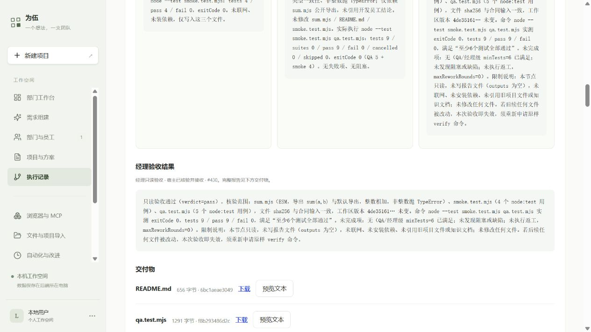
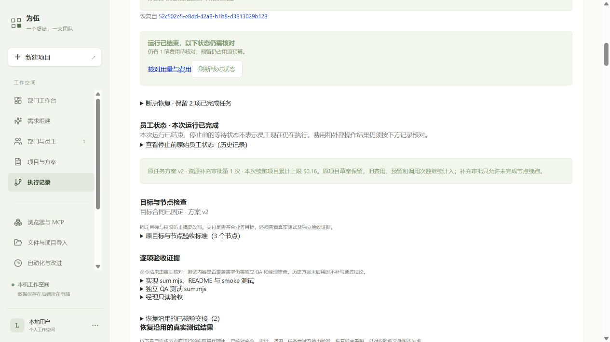

# AI 资源补充与恢复验收

2026-10-11：JJ 上的真实恢复运行已完成。经理独立复验 **9/9**，宿主接收正式 `pass`；开发与 QA 已完成节点没有重复调用或改写文件。此轮沿用用户批准的累计 **$2**，AI 实际选择项目上限 **$0.16**，低于授权最高 $0.18。

## 交付与使用

JJ 当前服务目录：`/home/jj/.local/share/weiwu/releases/weiwu-resources4-20261011`。Windows 访问 [网页结果](http://127.0.0.1:4312/#run/5bbc46e2-8dc5-496c-acca-b2abc8c282b8)，需保持已有 SSH 转发；连接方法见 [JJ 启动说明](../deployment-jj-quickstart-2026-10-09.md)。代码仍支持 [Windows 本机启动](../mvp-windows-quickstart-2026-10-07.md)。

常规使用继续走需求对话、确认方案、批准执行、逐项批准命令和查看交付。停止后在运行页面查看恢复条件；未知费用可以明确选择保留预留继续，未知修改操作仍须核对。

如果原调用额度或项目预算不足，展开“AI 调整续跑额度”，输入允许的项目累计上限、规划模型及本次规划费用上限，生成候选；检查未完成节点、旧费用及 AI 分配后，点击“确认额度并恢复未完成节点”。生成候选自身收费，但不会启动员工。确认保留原任务版本和全部历史，只创建新的资源审批子运行。无需修改数据库。

本次的员工交付为 [sum.mjs](goal-check-evidence-2026-10-10/resource-resume/sum.mjs)、[README](goal-check-evidence-2026-10-10/resource-resume/README.md)、两份原测试文件。下载到同一目录执行 `node --test smoke.test.mjs qa.test.mjs` 即可。Windows 原样复验也为 [9/9](goal-check-evidence-2026-10-10/resource-resume/windows-delivery-test.txt)。Codex 只读取、复制和核对，没有补写员工业务文件。

## 实际路径及证据

| 项目 | 证据 |
| --- | --- |
| 恢复项目 | `1d432498-6e6a-4da5-9833-4e946283f29b`，原任务方案 v2 |
| 重启时原运行 | `3d004ea7-bb65-48bc-9513-1b0511fd469f`，正常服务重启；[重启回执](goal-check-evidence-2026-10-10/restart-proof.json) |
| 第一轮恢复 | `8b8dff91-7a2f-4ba7-a079-792d2f06ff7c`；QA 完成，经理曾连接失败 |
| 原额度续跑失败 | `52c502e5-e8dd-42a8-b1b8-d3813029b128`；0 新请求，预算不足 |
| AI 资源候选 | `372fcdc6-244d-40d6-a55a-a042acce74ca`；上限 $0.16，经理调用总上限 12 次 |
| 最终恢复运行 | `5bbc46e2-8dc5-496c-acca-b2abc8c282b8`；**completed**，资源审批第 1 次 |
| 本次真实请求 | 经理 4 次、协调收尾 1 次；开发 0、QA 0；累计原方案调用 28/45，经理 9/12 |
| 经理真实测试 | 原命令 `node --test smoke.test.mjs qa.test.mjs`，9/9，退出码 0；[完整输出](goal-check-evidence-2026-10-10/resource-resume/e2b2b10a-2d67-46c4-b53b-cc07c21991cb.test-output.txt) |
| 正式验收 | `handoff/accepted #430`，`quality/reviewed` 有真实输入与测试凭据；[运行证据](goal-check-evidence-2026-10-10/resource-resume/proof.json) |
| 恢复完整性 | DAG、目标正文、验收条件、授权、模型及两份知识版本未变；4 个交付文件 SHA256 与重启前一致；继承证据状态 verified |

原封印 `53bed7b3…ce9f6` 保留在全部旧运行。新封印 `00a0003f…6f45` 同时绑定资源审批，因批准的预算与调用额度变化而更新；没有把资源变化冒称原封印不变。原项目草案 $0.13 未覆盖，旧计数与费用没有归零。详细逐字段核对及审批、祖先真实测试、知识版本和部署回执见 [独立核对 JSON](goal-check-evidence-2026-10-10/resource-resume/continuation-verification.json)。

## 费用与失败保留

恢复新增执行 $0.021171；三次资源规划合计 $0.0008817。第一个候选未通过范围校验，未建子运行；第二个候选保持原 $0.13 和 6 次调用，未批准。第三次加入实际已用、预留、净剩余和后续调用约束后，由 AI 返回可用方案。各次真实 Token 和费用均登记，未以固定响应替代。

截至验收结束，全部 JJ 测试已知费用 **$1.8798159**，旧未知预留 **$0.054876**，合计 **$1.9346919**，累计授权尚余 **$0.0653081**。恢复项目已知 $0.1126809、预留 $0.0352938，净剩余 $0.0120253。未知收据仍保留，未据后续成功推断旧请求未扣费。此处金额按已配置单价登记，不代表 Go 包月套餐百分比或供应商最终账单。

## 修复及工程验证

- 严格资源候选、明确确认与事务绑定，资源审批仅调整未完成节点，不允许借此完整重试。
- 新运行继续核算同一任务版本的实际调用、费用和预留；默认节点资金上限读取已批准运行额度。
- 恢复链逐条验证合法资源审批，保留原开发及 QA 文件与真实测试证据。
- 独立审查发现的已有子运行误用已修复：不同候选或普通恢复子运行不能满足资源确认；已有后续运行时，规划前拒绝新的付费请求。
- 修复资源表单与旧恢复按钮的重复 React key；网页定时刷新从132个重复按钮恢复为始终1个，[实际浏览器回归](goal-check-evidence-2026-10-10/resource-resume/browser-regression.json)保留。
- AI 规划明确累计预算范围、实际费用与预留、未完成节点的剩余调用要求；没有裁剪或手改 AI 输出。

相关检查均通过：纯逻辑及网页 32/32，恢复 API 14/14，完整本地主流程 18/18，继承证据 API 5/5，相关原生运行 48/48，合计 117 项；TypeScript 和 Vite 通过。API 回归使用隔离 PGlite 与测试模型，原生命令用真实临时目录。它们用于代码回归；上面的业务验收使用真实 DeepSeek、原 OpenShell 设备、实际命令及独立员工。

工程输出：[纯逻辑/网页](goal-check-evidence-2026-10-10/resource-resume/engineering-pure-ui.txt)、[恢复 API](goal-check-evidence-2026-10-10/resource-resume/engineering-recovery-api.txt)、[主流程及证据 API](goal-check-evidence-2026-10-10/resource-resume/engineering-api-full.txt)、[原生运行](goal-check-evidence-2026-10-10/resource-resume/engineering-runtime.txt)、[类型](goal-check-evidence-2026-10-10/resource-resume/engineering-types.txt)、[构建](goal-check-evidence-2026-10-10/resource-resume/engineering-build.txt)。普通完整套件此前仍有 PostgreSQL 未启动导致的 186 个失败，本轮没有重复该已知路径或宣称完整套件全绿；[既有记录](goal-check-2026-10-10.md#工程证据)保留。

四次新目录部署均核对项目、用量记录不变，发布自身 0 模型调用，旧代码和私有数据保留。网页刷新后已实查资源审批、历史费用、原真实 QA 测试、OpenShell 执行凭据、经理正式结果和下载入口。

## 工程选择与限制

资源审批单独编号，保留语义方案版本，避免改动全部历史查询；若绑定错误会错误放行，因此源运行、封印及节点等价有回归。旧“新批准版本”的提案含义最终落实为资源审批版本。实际部署、费用和验收独立核对，不由审查或替身测试推断；否则会高估完成度。后续资源规划仍受原项目草案的规划预算门禁约束；本轮仅验证这一次补充，原净额耗尽后的再次规划可能受阻。

两次真实候选问题通过明确范围和财务/调用上下文修正，未自动改写结果；若模型仍不遵守会拒绝并登记本次费用。第一份拒绝候选原输出未留存，只能确认范围校验失败及费用，无法复原具体错误值。本次独立审查没有暂缓 Minor；上一阶段“历史目标卡遇返工标签”的 Minor 仍保留在原报告。

这是短任务、正常关闭的受控服务重启，以及预算补充后的完整恢复验收。断电/SIGKILL、任意长任务语义正确性、持续自动队列、自动经验晋升和全容量回收尚未由本轮证明；本轮没有扩展这些功能。
