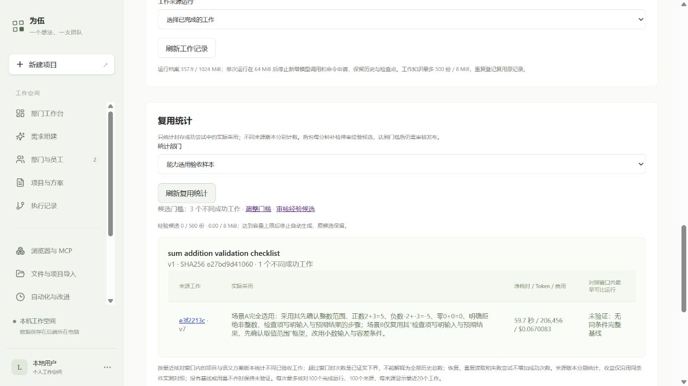
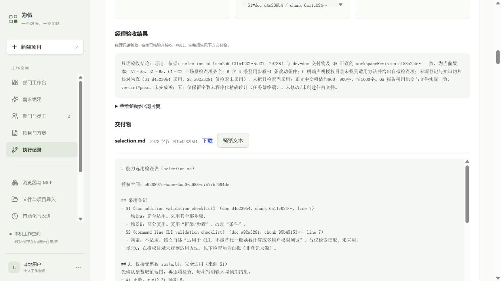

# 真实选用、复用统计与经验候选：阶段记录

日期：2026-10-11。状态：统计与待审候选已部署 JJ；真实三场景文档选用、独立 QA 来源核对和经理验收已完成，三个节点正式封存，成功复用统计为 1。相关工程验证与网页核对通过，实际发现的问题已修复。真实跨三工作自动候选与提速收益尚未验证；原费用、项目和员工文件保留。

## 实际实现

- 知识库新增“复用统计”。从正式封存工作投影采用来源，按项目与语义方案版本去重，源版本分别统计；读取、失败尝试、重复事件和恢复不会增加成功工作次数。
- 每次核对最近 100 个完成运行，每来源显示 20 个工作。超出窗口时明确是已证实下界，不冒称全历史总数；后台依据具体已核对工作生成候选，候选保留全部有界来源引用，发布时单独验证旧来源，不因其退出窗口而失效。
- 沿用现有真实用量及比较规则，统计页仅在同一有界窗口内找最早可比基线，后台候选不查效率基线；原完整工作记录仍保持原效率格式。缺失账单、恢复分段或没有基线时保持未知/未验证，不宣称采用带来提速。
- 后台每分钟补检，最多 20 个部门轮转。默认 3 个不同成功工作触发候选，设置页可改为 2～100；默认值是本次实现选择。候选正文和证据 JSON 自动生成合计最多 8 MiB / 500 份，数据库实际字节是最终门禁。
- 复用原知识候选表、人工整理、审查确认、原空间发布与加密备份。已有手工候选、编辑和已发布内容不覆盖。新候选只是确定性证据整理，未经语义提炼；不会自动成为 Skill 或工具。审核发布经验后，可在知识库明确发布为批准工作方法。
- 自动候选限同部门共享来源及可共享工作；公司来源只在授权报告中统计，员工私有资料即使所有参与员工可读也不汇入共享经验；临时定向输入缺少部门共享授权的工作不自动沉淀。归档、当前员工资料权限、固定版本及实际交付均检查，发布前重新核对。

## 最新真实验收结果

项目 `d4f37ca9-a891-4d32-b705-6a170f103a6b`，方案 v7，真实运行 **`e3f2213c-6eb0-4b0c-acba-5274bc891025`**；模型 DeepSeek V4.1 Flash，通过已保存的 OpenCode Go。使用既有 OpenShell 设备，开发与文档核对均在原授权范围执行。

| 检查项 | 实际结果与证据 |
| --- | --- |
| 自主选用 | 开发检索、加载 sum 方法，实际登记采用；A 整数场景完全适用，B 复用框架并修改小数/容差条件，C 无适用方法后生成新的检查项 |
| 独立 QA | 读取 selection.md，并实际 knowledge_read 两份原方法（事件 438/447）；逐项核对文件与来源后提交 pass |
| 经理验收 | 独立员工读取同版本文件，结合 QA 报告与只读检索提交 pass；没有写文件或执行终端 |
| 正式完成 | 3/3 accepted seals、3 次回合终止标记，文件版本、任务尝试与档案完整性通过宿主核对 |
| 固定资料 | 三位员工只授权验收空间；knowledgeDocumentIds 固定两份 v1，快照和实际引用 ID/版本/SHA 一致 |
| 网页 | 成功工作数 1，刷新仍为 1；来源链接进入已完成运行，交付可下载、可预览，费用与无基线状态可见 |

交付：[员工原样生成的 accepted-selection.md](evidence/reuse-learning-2026-10-11/accepted-selection.md)，2978 字节，SHA256 `f31b4232f5f197abbf221e69f71a8111fd04f0ef4dee738482e2608d0b8a5527`。开发输出与 QA/经理输入为同一 SHA256 / workspaceRevision。Codex 只下载、核对并复制证据，没有补写交付。

QA/经理粗估为 800～900 汉字，实际精确统计为 **649 汉字**；含英文引用标识、标点和换行共 **1392 Unicode 字符**。本次“千中文字”按汉字口径核对，不把此文件声称为“全部字符少于 1000”。粗估误差保留在原报告，机器字数门禁尚未接入。其他语义检查仍是模型判断；本次是文档检查表的质量验证，没有新的代码测试或终端测试输出。

成功运行耗时 **59.711 秒**，**20 次模型请求、206,456 Token、登记费用 $0.0670083**。项目含规划与所有失败尝试累计 **$0.1361265 / $0.15**；全 JJ 已知 **$2.0159424** 加旧未知预留 **$0.054876**，合计 **$2.0708184 / $2.10**，剩余 **$0.0291816**。这是按配置单价的预算口径，以供应商账单为准。没有新未知费用，旧预留未清零。

来源成功统计为 **1 个不同工作**，不把失败版本计入。默认门槛 3，所以真实候选仍为 0；没有同条件完整首次运行，网页显示“未验证”，不宣称复用带来提速、Token 或费用减少。

完整证据：[封存、角色权限、引用和费用](evidence/reuse-learning-2026-10-11/accepted-real-proof.json)、[正式工作记录投影](evidence/reuse-learning-2026-10-11/accepted-work-record.json)、[实际统计](evidence/reuse-learning-2026-10-11/accepted-reuse.json)、[QA 原报告](evidence/reuse-learning-2026-10-11/qa-completion.txt)、[经理原报告](evidence/reuse-learning-2026-10-11/manager-completion.txt)、[网页运行摘要](evidence/reuse-learning-2026-10-11/jj-accepted-run.txt)。完整原始运行共有 716 条事件，归档保留在 JJ；普通运行 API 首页只返回最多 300 条，本次用既有 export 接口核对完整记录，不把首屏事件当全量。

## 网页怎么使用

1. 在知识库发布批准方法，在部门编辑页授权其知识空间并开启知识检索/读取。新任务中由员工自行检索和选择。
2. 进入“知识库 → 复用统计”，选择部门并刷新。查看来源版本、成功工作次数、采用说明及真实耗时、Token、费用；没有完整基线时显示未验证。
3. “调整门槛”进入系统设置，默认 3、允许 2～100 个不同成功工作；修改后点“保存策略”。此次浏览器验证只读取默认值，没有保存生产设置。
4. 达到门槛后，进入“自动化与改进 → 审查候选”，核对采用条件、来源和反例，整理正文后明确同意发布到原空间。经验发布为 Skill 还需知识库中的明确方法发布；不会自动安装工具。

当前测试部门有 1 个已验收成功工作，未达到默认 3 次门槛，显示 0 个候选符合实际证据。普通检索、重复恢复和历史失败版本都不会增加成功次数。

初次发布、追加真实验收之前的 0 计数截图保留：[历史入口截图](evidence/reuse-learning-2026-10-11/jj-knowledge.png)。它不代表当前状态。

## JJ 发布与保留核对

代码提交 `739ba8e`，审查修复 `ab7423e`，任务 ID 修复 `9332d0e`。当前 release：`/home/jj/.local/share/weiwu/releases/weiwu-reuse-alias2-20261011`；前一个 `weiwu-reuse-learning1-20261011` 及更早 release 保留。复用现有固定依赖，部署本身新增模型调用 0 次。JJ 本机相关 API 15 项及宿主回归 21 项通过，服务及数据库健康。

发布前后 7 个项目状态/版本、371 条用量的金额与 Token 一致；全部 349 份运行档案文件、368,992,033 字节与清单哈希一致。原运行 `f86bfd4f-265d-43f4-ad30-5c5c1140dd92` 的 README.md、cli.mjs、cli.test.mjs 又通过实际下载 SHA256 核对。没有覆盖数据目录或更改设备权限。

浏览器实际刷新统计并查看设置，默认门槛 3、输入边界 2～100，未提交设置；复用与审查入口可见。首次精确 label 选择器没有匹配包含帮助文字的可访问名称，改用实际 role/名称读取完成核对；没有因此修改产品或保存数据。

证据：[部署与 JJ 回归输出](evidence/reuse-learning-2026-10-11/jj-deployment.txt)、[发布清单](evidence/reuse-learning-2026-10-11/deployment.json)、[生产只读核对](evidence/reuse-learning-2026-10-11/jj-live-audit.json)、[网页文字](evidence/reuse-learning-2026-10-11/jj-knowledge-dom.txt)、[设置边界](evidence/reuse-learning-2026-10-11/jj-settings.json)。

## 早期真实模型失败：完整保留

独立验证部门 `62558bb0-cc2e-4356-ae7f-d53f919fec93`，项目 `d4f37ca9-a891-4d32-b705-6a170f103a6b`。原研发部门及旧项目没有修改。两份短方法是明确标注的验收资料，员工交付由真实 DeepSeek V4.1 Flash 生成。

1. 真实规划返回候选 `52edc2b7-68a6-4090-8a89-5657d1a321e0`。把文档工作后的核对标成 `review`，不符合当前仅审查 implementation/repair 的合同。Codex 只把两个文档核对节点改为 `work`，去掉 reviewedTaskId；AI 原预算、调用分配、三个员工、文件和标准未改。现有代码审查门禁没有放宽。这项检查不冒称一次新的代码独立测试。
2. 首次运行 `cadb094e-0902-4e2c-a9e5-e94b53fb1b86` 在单次 1024 Token 上限截断，宿主拒绝采纳为完成或执行截断工具，费用保留。没有已完成节点。
3. 单次输出改为 2048，方案 v3、运行 `86ca97da-dd42-47a8-8f57-be50e6834cab`。真实员工加载固定 sum-checklist，检索公司目录，读取来源并登记采用。说明整数场景采用、小数场景只复用步骤并调整条件、权限场景不采用无关方法，生成 selection.md。
4. 后续请求在发送前因 `BUDGET_CONTEXT_LIMIT` 停止：该任务净剩余 $0.01000220，保持完整受保护上下文及 2048 输出的最低预留 $0.01204530，至少差 $0.00204310。不存在这一次被门禁阻止请求的供应商扣费；此前真实请求实际用量另有记录。

[真实事件、费用与文件哈希](evidence/reuse-learning-2026-10-11/real-proof.json)。[员工原样生成的 selection.md](evidence/reuse-learning-2026-10-11/partial-selection.md)，2882 字节，SHA256 `08cdbecc9d3f0abd8526c6e66d8a788876bf42459f3b2c160c188de26f4d7f7e`。Codex 仅复制并核对，没有补写或修改。

截至当时，没有成功封存节点，QA 与经理核对未完成，计数为 0，不作为已验收经验。当时本轮真实规划及执行登记费用 $0.0304191；全 JJ 已知 $1.910235，旧未知预留 $0.054876，累计 $1.965111，原 $2 上限剩余 $0.034889。这是历史预算状态，不代表目前剩余额度或 Go 包月供应商最终账单。

以上为追加批准前的账面与截图。用户随后批准累计 $2.10 / 本项目 $0.15，后续另有真实规划与执行费用，旧值不能解释为现在剩余额度。

## 批准后的续办与新发现

- 真实 AI 候选 `fc0a609c-0b36-4809-bfae-9186d9feac6e` 分配开发 $0.05/8 次、QA $0.03/4 次、经理 $0.025/4 次，并缩减 QA/经理为仅文件读取。确认为 v5，运行 `ad2dc687-a518-4c2f-ade8-b75e44302ee3` 再次生成真实 selection.md。
- 开发用方案 ID `dev-doc` 提交正式完成，内部 AgentTeams 任务采用另一原生 ID；旧宿主只认原生 ID，事件 291 返回 `TASK_NOT_ACTIVE`。后续在发送前触发次数门禁。恢复检查证明已用 8/8、没有已封存节点、项目净剩余 $0.0861018，没有新的未知费用或外部操作。保留完整失败记录，未盲目重放。
- 修复 `9332d0e`：在员工桥接层、原生工具输入冻结之前，把唯一获批准语义 ID 映射到原生 ID；保留当前分派、员工身份、attempt 和正式交付校验。过期或其他员工的任务仍被拒绝，正式封存后终止当前回合。原生库文件未修改。新增真实 Host 夹具 RED→GREEN，相关 21 项及一次终止标记补充断言通过。
- JJ 首次修复发布在切换服务前因缺少既有工程 fixture 文件而失败，原服务与数据未切换。加入所需 8 份夹具后，第二个独立 release `weiwu-reuse-alias2-20261011` 的 21 项通过再切换；失败目录保留，原 release 保留。7 项目、380 条用量与全 358 份档案的发布前后哈希一致。此修复与部署新增付费调用为 0。
- 在已批准总额内，把本样本的新策略调用上限改为单任务 16 / 方案 32，不改变 $0.15 总预算。真实 AI 候选 `622026d2-8907-494f-915a-b87efb57c78c` 分配 16/8/8 次，却把开发金额缩至 $0.028，低于已观察的 $0.0281958 且没有后续完整上下文余量，因此没有启动该提案。准备沿用前一个真实 AI 的节点金额上限及新 AI 的次数分配；节点共享项目门禁，不相加提高总额度。
- 原方案的权限过滤保留 QA/经理仅文件读取，来源核对需要恢复验收空间的两项只读知识工具。自动审批审查首次拒绝准备脚本，当时未执行。用户随后明确允许只限这两份方法，才执行访问调整；资料 ID 另显式固定，不授权其他文档。详见 [权限差异与访问范围](reuse-learning-qa-access-2026-10-11.md)。
- 实施者核对两份真实 AI 提案，保留此前 $0.05/$0.03/$0.025 节点金额，采用最新 16/8/8 次数，在共享 $0.15 门禁内显式保存为 v7 并执行。这是人工核对的 AI 提案组合，不是未经调整的生成候选，也不是 v5 检查点续跑：旧版本没有已封存节点，新版本重新执行文档任务，旧费用仍计入。v7 已完成上述真实核对。

后续证据：[恢复门禁](evidence/reuse-learning-2026-10-11/continuation-recovery-check.txt)、[任务 ID 复现](evidence/reuse-learning-2026-10-11/red-task-alias.txt)、[宿主修复回归](evidence/reuse-learning-2026-10-11/task-alias-final.txt)、[JJ 修复发布](evidence/reuse-learning-2026-10-11/jj-alias-deployment-final.txt)、[工程退出码](evidence/reuse-learning-2026-10-11/verification.json)。这项运行时补丁由实施者依据真实失败与回归核对，不在先前独立审查的提交范围内。

## 工程证据

- 相关 API 22 项：新采用/候选 10、原工作记录 4、原自动化 5、加密备份隔离恢复 3；规范字节门禁另核对过新 7 项，不重复累计数量。
- UI、授权设置与效率 8 项；类型检查与网页构建通过，保留已有大于 500 kB bundle 提示。
- 任务 ID 修复的相关宿主/交接回归 21 项通过；新增终止标记断言另按同一用例单独核对通过，不重复计为第 22 项。最终运行没有再次改动功能代码，沿用该已验证提交。
- RED 证据：统计入口不存在、网页入口不存在、自动候选缺容量保护、部门长期固定 first-20、历史窗口阻止新候选，随后均有对应 GREEN。
- 初次夹具没有从实际 API 读取哈希、未声明任务员工，宿主正确拒绝；修正夹具后验证，没有因此弱化产品门禁。首次 UI 命令缺 TSX 加载器，改用项目既有 --import tsx。
- 所有协议夹具仅证明工程行为，不算真实模型 QA 或经理验收。

输出：[API](evidence/reuse-learning-2026-10-11/final-api.txt)、[最终采用 API](evidence/reuse-learning-2026-10-11/final-reuse-api.txt)、[UI 与效率](evidence/reuse-learning-2026-10-11/final-ui.txt)、[类型](evidence/reuse-learning-2026-10-11/types.txt)、[构建](evidence/reuse-learning-2026-10-11/build.txt)。

## 独立审查与修复

一次 fresh-context 审查，初始结论为 changes requested；发现 1 项 P1 和 2 项 P2，随后均有 RED→GREEN：单员工同时拥有共享方法和员工私有资料时，原参与者检查会误判可共享；候选发布只比较原文哈希列，正文腐坏未被重新计算；后台正式工作构造会间接遍历无界旧基线。共同工作证据现在检查所有来源空间、发布重算固定正文哈希、后台独立核对有界证据，统计只在已核对窗口内比较。没有再开第二次审查，不冒称审查者独立确认了修复后的版本。

[审查记录](evidence/reuse-learning-2026-10-11/review.md) · [三项复现](evidence/reuse-learning-2026-10-11/red-review.txt)。

## 待完成与实施边界

- 独立审查、修复、JJ 发布与网页入口核对：已完成工程验证；独立审查初始为 changes requested，修复由实施者核对。
- 完整真实文档选用 → QA 来源核对 → 经理验收：已完成，v7 三个节点正式封存。早期未验收文件和费用保留；没有把普通完成文字当作正式封存。
- 真实跨三工作自动候选、同条件复用收益：尚未验证。经验候选的生成、授权重校验、幂等和隔离备份恢复已有工程证据；当前真实 1 次不伪造为 3 次。
- 语义经验提炼、工具生成、自动晋升：未实现；普通候选整理及明确发布入口已有。模型字数粗估误差仍存在，本次另有精确统计，不冒称宿主已提供机器字数门禁。
- AI 对多轮上下文的费用估算仍偏低：v7 执行估算 $0.031393，实际登记 $0.0670083。总额和节点硬门禁有效，但当前还需审核 AI 的分配，不能据此承诺预测准确或以后所有类似任务都可用这个最低额度完成。
- 此次新版本执行不作为新增的受控重启恢复验收。此前正常/重启路径证据保留；当前资源补充接口尚不能改变绑定节点金额与策略次数上限，本次用明确确认的新方案解决，旧成本没有清零。
- 统计是有界核对窗口；自动候选中证据固定，不随新工作覆盖人工审核。相同来源正文哈希的不同修订沿用原候选去重，统计仍分开固定版本。
- 本轮没有外部市场研究接入、新依赖、图数据库、全量自动清理或权限扩大。
