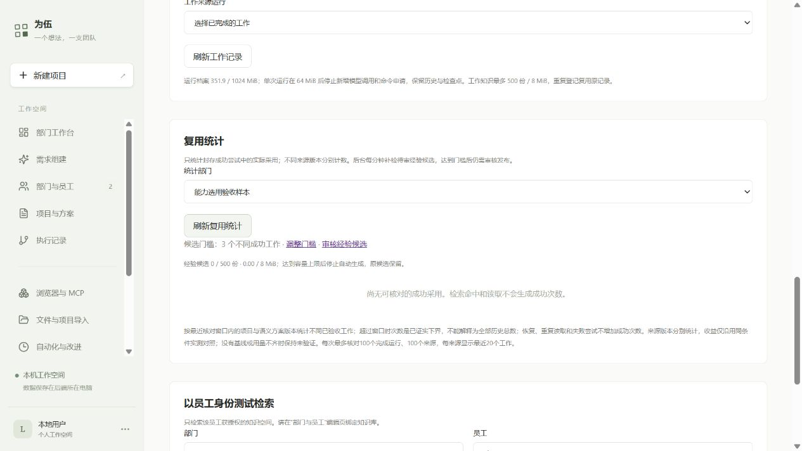

# 真实选用、复用统计与经验候选：阶段记录

日期：2026-10-11。状态：统计与待审候选已部署 JJ，相关工程验证与网页核对通过；独立审查发现的三项问题已复现并修复。真实选用已有部分证据，QA/经理核对受预算阻塞，整项验收未通过。原预算、费用、权限、项目和员工文件保留。

## 实际实现

- 知识库新增“复用统计”。从正式封存工作投影采用来源，按项目与语义方案版本去重，源版本分别统计；读取、失败尝试、重复事件和恢复不会增加成功工作次数。
- 每次核对最近 100 个完成运行，每来源显示 20 个工作。超出窗口时明确是已证实下界，不冒称全历史总数；后台依据具体已核对工作生成候选，候选保留全部有界来源引用，发布时单独验证旧来源，不因其退出窗口而失效。
- 沿用现有真实用量及比较规则，统计页仅在同一有界窗口内找最早可比基线，后台候选不查效率基线；原完整工作记录仍保持原效率格式。缺失账单、恢复分段或没有基线时保持未知/未验证，不宣称采用带来提速。
- 后台每分钟补检，最多 20 个部门轮转。默认 3 个不同成功工作触发候选，设置页可改为 2～100；默认值是本次实现选择。候选正文和证据 JSON 自动生成合计最多 8 MiB / 500 份，数据库实际字节是最终门禁。
- 复用原知识候选表、人工整理、审查确认、原空间发布与加密备份。已有手工候选、编辑和已发布内容不覆盖。新候选只是确定性证据整理，未经语义提炼；不会自动成为 Skill 或工具。审核发布经验后，可在知识库明确发布为批准工作方法。
- 自动候选限同部门共享来源及可共享工作；公司来源只在授权报告中统计，员工私有资料即使所有参与员工可读也不汇入共享经验；临时定向输入缺少部门共享授权的工作不自动沉淀。归档、当前员工资料权限、固定版本及实际交付均检查，发布前重新核对。

## 网页怎么使用

1. 在知识库发布批准方法，在部门编辑页授权其知识空间并开启知识检索/读取。新任务中由员工自行检索和选择。
2. 进入“知识库 → 复用统计”，选择部门并刷新。查看来源版本、成功工作次数、采用说明及真实耗时、Token、费用；没有完整基线时显示未验证。
3. “调整门槛”进入系统设置，默认 3、允许 2～100 个不同成功工作；修改后点“保存策略”。此次浏览器验证只读取默认值，没有保存生产设置。
4. 达到门槛后，进入“自动化与改进 → 审查候选”，核对采用条件、来源和反例，整理正文后明确同意发布到原空间。经验发布为 Skill 还需知识库中的明确方法发布；不会自动安装工具。

当前测试部门没有已验收成功工作，显示 0 个候选符合实际证据。普通检索、重复恢复或这次未验收报告都不会触发成功次数。

## JJ 发布与保留核对

代码提交 `739ba8e`，审查修复 `ab7423e`。新 release：`/home/jj/.local/share/weiwu/releases/weiwu-reuse-learning1-20261011`，原 release 保留。复用现有固定依赖，部署和核对新增模型调用 0 次。JJ 本机相关 API 15 项通过，服务及数据库健康。

发布前后 7 个项目状态/版本、371 条用量的金额与 Token 一致；全部 349 份运行档案文件、368,992,033 字节与清单哈希一致。原运行 `f86bfd4f-265d-43f4-ad30-5c5c1140dd92` 的 README.md、cli.mjs、cli.test.mjs 又通过实际下载 SHA256 核对。没有覆盖数据目录或更改设备权限。

浏览器实际刷新统计并查看设置，默认门槛 3、输入边界 2～100，未提交设置；复用与审查入口可见。首次精确 label 选择器没有匹配包含帮助文字的可访问名称，改用实际 role/名称读取完成核对；没有因此修改产品或保存数据。

证据：[部署与 JJ 回归输出](evidence/reuse-learning-2026-10-11/jj-deployment.txt)、[发布清单](evidence/reuse-learning-2026-10-11/deployment.json)、[生产只读核对](evidence/reuse-learning-2026-10-11/jj-live-audit.json)、[网页文字](evidence/reuse-learning-2026-10-11/jj-knowledge-dom.txt)、[设置边界](evidence/reuse-learning-2026-10-11/jj-settings.json)。

## 真实模型验证：部分完成

独立验证部门 `62558bb0-cc2e-4356-ae7f-d53f919fec93`，项目 `d4f37ca9-a891-4d32-b705-6a170f103a6b`。原研发部门及旧项目没有修改。两份短方法是明确标注的验收资料，员工交付由真实 DeepSeek V4.1 Flash 生成。

1. 真实规划返回候选 `52edc2b7-68a6-4090-8a89-5657d1a321e0`。把文档工作后的核对标成 `review`，不符合当前仅审查 implementation/repair 的合同。Codex 只把两个文档核对节点改为 `work`，去掉 reviewedTaskId；AI 原预算、调用分配、三个员工、文件和标准未改。现有代码审查门禁没有放宽。这项检查不冒称一次新的代码独立测试。
2. 首次运行 `cadb094e-0902-4e2c-a9e5-e94b53fb1b86` 在单次 1024 Token 上限截断，宿主拒绝采纳为完成或执行截断工具，费用保留。没有已完成节点。
3. 单次输出改为 2048，方案 v3、运行 `86ca97da-dd42-47a8-8f57-be50e6834cab`。真实员工加载固定 sum-checklist，检索公司目录，读取来源并登记采用。说明整数场景采用、小数场景只复用步骤并调整条件、权限场景不采用无关方法，生成 selection.md。
4. 后续请求在发送前因 `BUDGET_CONTEXT_LIMIT` 停止：该任务净剩余 $0.01000220，保持完整受保护上下文及 2048 输出的最低预留 $0.01204530，至少差 $0.00204310。不存在这一次被门禁阻止请求的供应商扣费；此前真实请求实际用量另有记录。

[真实事件、费用与文件哈希](evidence/reuse-learning-2026-10-11/real-proof.json)。[员工原样生成的 selection.md](evidence/reuse-learning-2026-10-11/partial-selection.md)，2882 字节，SHA256 `08cdbecc9d3f0abd8526c6e66d8a788876bf42459f3b2c160c188de26f4d7f7e`。Codex 仅复制并核对，没有补写或修改。

没有成功封存节点，QA 与经理核对尚未完成；本次成功复用计数为 0，不作为已验收经验。本轮真实规划及执行登记费用 $0.0304191；全 JJ 已知 $1.910235，旧未知预留 $0.054876，累计 $1.965111，原 $2 上限剩余 $0.034889。这是按现有单价登记的预算口径，不代表 Go 包月供应商最终账单。

## 工程证据

- 相关 API 22 项：新采用/候选 10、原工作记录 4、原自动化 5、加密备份隔离恢复 3；规范字节门禁另核对过新 7 项，不重复累计数量。
- UI、授权设置与效率 8 项；类型检查与网页构建通过，保留已有大于 500 kB bundle 提示。
- RED 证据：统计入口不存在、网页入口不存在、自动候选缺容量保护、部门长期固定 first-20、历史窗口阻止新候选，随后均有对应 GREEN。
- 初次夹具没有从实际 API 读取哈希、未声明任务员工，宿主正确拒绝；修正夹具后验证，没有因此弱化产品门禁。首次 UI 命令缺 TSX 加载器，改用项目既有 --import tsx。
- 所有协议夹具仅证明工程行为，不算真实模型 QA 或经理验收。

输出：[API](evidence/reuse-learning-2026-10-11/final-api.txt)、[最终采用 API](evidence/reuse-learning-2026-10-11/final-reuse-api.txt)、[UI 与效率](evidence/reuse-learning-2026-10-11/final-ui.txt)、[类型](evidence/reuse-learning-2026-10-11/types.txt)、[构建](evidence/reuse-learning-2026-10-11/build.txt)。

## 独立审查与修复

一次 fresh-context 审查，初始结论为 changes requested；发现 1 项 P1 和 2 项 P2，随后均有 RED→GREEN：单员工同时拥有共享方法和员工私有资料时，原参与者检查会误判可共享；候选发布只比较原文哈希列，正文腐坏未被重新计算；后台正式工作构造会间接遍历无界旧基线。共同工作证据现在检查所有来源空间、发布重算固定正文哈希、后台独立核对有界证据，统计只在已核对窗口内比较。没有再开第二次审查，不冒称审查者独立确认了修复后的版本。

[审查记录](evidence/reuse-learning-2026-10-11/review.md) · [三项复现](evidence/reuse-learning-2026-10-11/red-review.txt)。

## 待完成与实施边界

- 独立审查、修复、JJ 发布与网页入口核对：已完成工程验证；独立审查初始为 changes requested，修复由实施者核对。
- 完整真实员工选用 → QA → 经理验收：预算阻塞。当前资源续跑接口调整项目预算与调用次数，不调整绑定的节点 maxBudget；不能盲目重复该路径解决本次节点额度不足。需重新规划明确的节点分配，原费用与未验收文件仍保留。
- 真实跨不同成功工作的复用收益、语义经验提炼、工具生成和自动晋升：未验证/未实现；普通候选整理及明确发布入口已有。
- 统计是有界核对窗口；自动候选中证据固定，不随新工作覆盖人工审核。相同来源正文哈希的不同修订沿用原候选去重，统计仍分开固定版本。
- 本轮没有外部市场研究接入、新依赖、图数据库、全量自动清理或权限扩大。
