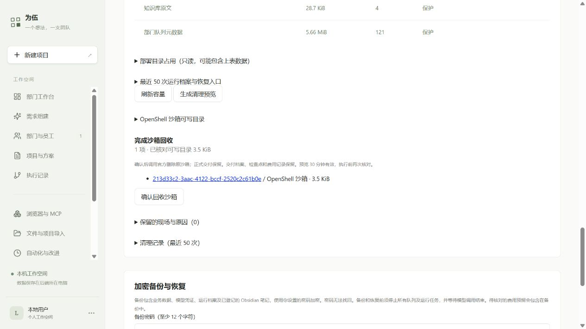

# 沙箱与日志生命周期第二批验收

2026-10-11。基于第一批 `f8ef71f`，保留原项目、员工交付、费用与凭据。本批增加网页维护和受控资源监管，复用固定 OpenShell 0.1.2 CLI、Node 文件系统及 gzip；没有新依赖、模型/员工调用或预算调整。**本批完成了下面列出的维护验证；多小时员工自主运行仍未验证。**

## 能力与修复

| 能力 | 结果 |
| --- | --- |
| 沙箱目录容量 | 固定 /sandbox 20 MiB、128 文件、512 条目；/tmp 64 MiB、4096 条目；可用磁盘至少 256 MiB。受控命令每 250 ms 检查，超限终止并保留未知现场 |
| 停止后的核对 | 网页显式启动原沙箱，重新核对授权、原 ID、文件版本及实际逻辑字节，不调用模型 |
| 完成沙箱回收 | 完成运行、无待核对费用/外部操作、与交付相同版本才可预览和确认。先持久化意图，再单次官方 delete；请求已接受不能当作已删除 |
| 中断与重复 | 重复确认读取已有记录；删除中断后只查询原 ID。仍在或未核对的结果保留再次只读查询入口，包括旧 interrupted 记录 |
| 完成日志归档 | gzip 与 manifest 持久化、重新校验后才删除热日志。事件/快照不变，列表、冷日志读取和备份兼容；封存后不可追加 |
| 小日志与净收益 | 节省量包含 manifest 字节；压缩没有净收益时在写入前拒绝，原日志保留 |
| 临时目录竞争 | 普通子条目删除/重命名引起 ENOENT/ENOTDIR 最多重扫三次，扫描根身份固定；权限、链接、容量超限和持续无法核对仍阻断 |

三项 Important 审查发现均经失败用例复现并修复：核对入口丢失、临时条目变动误杀、压缩收益漏算。没有遗留的本轮 Minor 审查项。使用方法见 [网页容量维护](../storage-governance.md)。

## 工程验证

| 范围 | 通过数与原始输出 |
| --- | --- |
| Windows 真实目录与 OpenShell 执行器协议 | [28/28](evidence/sandbox-lifecycle-2026-10-11/review-churn-green.txt) |
| 日志归档与正式交付副本保护 | [7+14/21](evidence/sandbox-lifecycle-2026-10-11/review-net-green.txt) |
| 事件、列表缓存、追加游标与档案门禁 | [21/21](evidence/sandbox-lifecycle-2026-10-11/trace-final.txt) |
| 维护 HTTP API 与加密备份恢复 | [19+3/22](evidence/sandbox-lifecycle-2026-10-11/api-backup-final.txt) |
| 费用与恢复条件 | [10+14/24](evidence/sandbox-lifecycle-2026-10-11/cost-recovery-final.txt) |
| 网页视图与再次核对入口 | [7/7](evidence/sandbox-lifecycle-2026-10-11/ui-final.txt) |
| JJ Linux 部署前测试 | [50/50](evidence/sandbox-lifecycle-2026-10-11/jj-deployment.txt) |
| TypeScript、Vite 构建 | 退出码 0；[类型输出](evidence/sandbox-lifecycle-2026-10-11/types-final.txt)、[构建输出](evidence/sandbox-lifecycle-2026-10-11/build-final.txt) |

备份夹具实际压缩完成日志、加密导出、隔离恢复后读取同一批事件与交付文件；原生产环境未被恢复实验覆盖。PGlite 使用单产品连接，不能证明独立 PostgreSQL 后端锁竞争。命令写临时文件超限使用协议夹具和真实本地文件验证，不宣称已在物理 OpenShell 中触发硬配额。

公开测试输出仅规范行尾空白，原始副本保留在本机隔离资料中。测试期间 Windows 受限权限拒绝过链接、网络及 Vite realpath；正常测试权限和 Linux 回归已验证相应能力。一次集成命令用了两个不存在的旧测试路径，已改正并分别保存完整通过输出。未重跑依赖独立 PostgreSQL 的全仓原始测试命令。既有 JS 包超过 500 kB 的构建警告保留。

## JJ 实际证据

当前发布 `/home/jj/.local/share/weiwu/releases/weiwu-lifecycle1-20261011`，服务 `weiwu-jj.service`，原发布和固定依赖保留。更新包 SHA-256 `fbd55f11830602ff13c415c78530efd16b3db252fcc51ffaaae8a48e353c3e42`。[部署证据](evidence/sandbox-lifecycle-2026-10-11/deployment.json)

独立测试沙箱 `d21d4c80-c398-4b87-9934-ebeb4334177b`，测试运行 `eee48e21-159c-482c-934f-c38b1f1b9e0c`：只复制既有员工运行 `f86bfd4f-265d-43f4-ad30-5c5c1140dd92` 的 README、CLI 和测试文件，来源 SHA 与生产档案逐文件一致，Codex 没有改写交付内容。12 次间隔约 5 秒采样中 /sandbox 保持 14988 B、3 个文件，/tmp 为 0 B；关闭执行器后用新执行器恢复同一沙箱及同一文件版本，再单次回收，重复操作读取相同回执。[实测证据](evidence/sandbox-lifecycle-2026-10-11/physical.json)原件 `/home/jj/.local/share/weiwu/probes/lifecycle-3o1BRA/evidence.json`。

这次物理采样在最后的有界重扫修复前完成；最终修复经 Windows 与部署前 Linux 回归验证。短时采样使用原沙箱工作负载，不运行模型或员工长任务，不能作为多小时自主开发证据。

网页核对既有正常运行 `213d33c2-3aac-4122-bccf-2520c2c61b0e`，原沙箱 `f93b85e2-cf54-48b2-9b94-705655526e5f`：/sandbox 3540 B、4 文件，/tmp 0 B，版本 `526e57323402196b443e4a668ebae029c14c513da2056b95e33a98f7d0293108`。网页实际生成回收预览 `f2fe3b0d-b30f-4532-b2f5-45336d5559a9`；日志预览 `8d26bbfb-4c06-4191-b2c7-d2b3767d6c42` 由 API 验证。生产确认按钮未点击，原日志未压缩。

随后受控服务重启 PID `3071210` → `3095893`：两种预览、清理历史、费用、容量快照、原沙箱 ID 和文件版本保留，原沙箱正常停止。[重启证据](evidence/sandbox-lifecycle-2026-10-11/live-restart.json)

全部 6 个项目版本/状态、362 条用量记录和 332 个原档案文件（366882161 B）与基线一致，正常与恢复运行均保持 completed / integrity ok。生产文件删除 0、生产日志归档 0、本轮模型与员工调用 0；原 $2 授权不变，原已用与未知预留合计 $1.934692，剩余 $0.065308，未把未知费用按零结算。[汇总与核对范围](evidence/sandbox-lifecycle-2026-10-11/summary.json)

## 边界与后续

本轮选择应用监管，没有修改 Docker 硬配额。固定 CLI 帮助没有通用磁盘参数，管理员存储驱动支持尚未验证；这一选择的代价是无法保证 OS 层写入上限。统计为普通文件逻辑字节，不包含镜像层、Docker 日志与分配块数；突发写入可能在两次采样间越限。

本轮采用约一分钟生命周期采样，没有新增付费长任务；代价是多小时员工运行、全部临时文件类型与持续目录竞争的真实业务行为仍待验证。没有默认自动删除、旧发布/缓存回收策略或清理历史整理入口；维护元数据达到既有上限后拒绝新增，保留历史。大档案在线备份仍受既有上限约束。

官方停止保留存储、删除回收及 accepted/pending 的语义参考 [OpenShell 0.1.2 沙箱文档](https://docs.nvidia.com/openshell/v0.1.2/how-it-works/sandboxes/overview)。下一步应在现有小任务基础上做受控耐久验证，观察目录、日志与上下文增长后确定保留策略；知识经验晋升、Skill/工具闭环和长期部门调度仍是独立后续工作，不计入本批完成。
