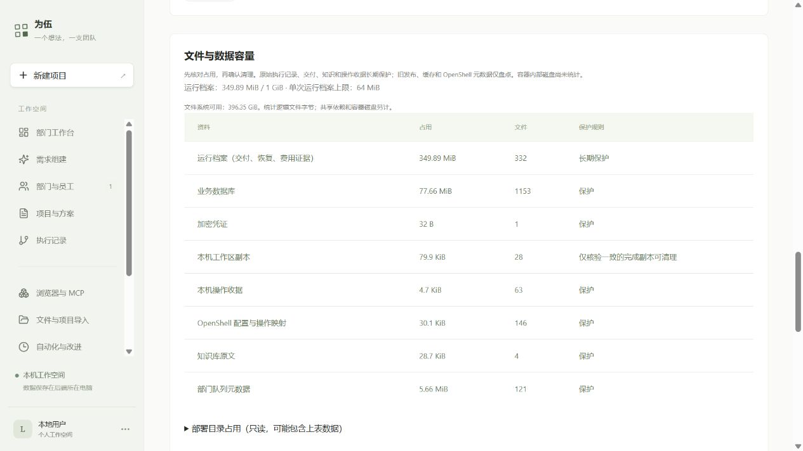
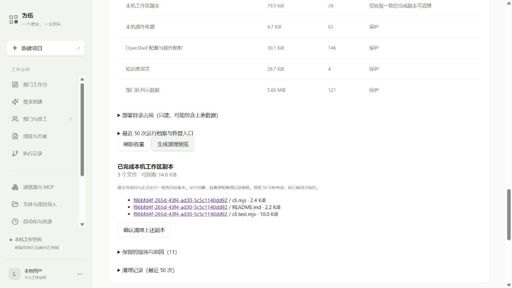

# 文件与数据治理第一批验收

2026-10-11。从 `a9f84198b34b4c418708ad843c0b7d1eb7713fbf` 继续，保留已有成果和无关未跟踪文件。本批只完成容量可见、受控副本清理及保护门禁，不新增依赖，不调用付费模型。

## 已交付

| 能力 | 结果与证据 |
| --- | --- |
| 网页分类盘点 | 设置页显示档案、数据库、工作区、知识、收据与部署目录；实际截图见下方 |
| 清理预览与确认 | 只允许完成的 native 运行、无未知操作、完整快照和日志、与交付相同的普通副本；临时真实文件删除成功 |
| 文件与运行保护 | 变化、链接、硬链接、未知操作、活动/失败运行及无交付副本均拒绝或保留；正式交付和日志不变 |
| 重复与中断 | 持久化 started 后再删除；重复确认读取结果；中断后显式核对现状、不续删；实际 HTTP 服务重建测试通过 |
| 实际 JJ 重启 | PID `2953005` → `2957354`，同一预览、清理历史和待核对费用保留；生产删除 0，模型调用 0 |
| 备份 | 清理记录随加密备份在隔离夹具恢复；旧备份恢复为空表，原环境未做覆盖实验 |
| 增长门禁 | 保留 64 MiB / 1 GiB 档案门禁；新增 256 MiB 磁盘门禁覆盖对话、规划和执行；扫描/查询/清单有界；预览去重及容量检查事务化 |

使用方法见 [文件与数据容量](../storage-governance.md)。

## 工程验证

| 检查 | 结果 |
| --- | --- |
| Windows 真实临时文件与已有档案门禁 | 14 / 14 |
| 清理 HTTP API、真实文件、隔离 PGlite | 12 / 12 |
| 费用与需求对话回归 | 10 / 10 |
| 加密备份与旧格式恢复回归 | 3 / 3 |
| 恢复条件与原预算回归 | 14 / 14 |
| 网页静态视图 | 4 / 4 |
| JJ Linux 新文件模块 | 13 / 13 |
| TypeScript `--noEmit`、Vite 生产构建 | 退出码 0；既有 JS 包超过 500 kB 警告仍在 |

本批此前的现有产品流程另有 18 / 18 通过，包含本机命令和恢复；最后一次共享磁盘门禁变更后重跑了上表费用及恢复回归。[原始通过日志与检查清单](evidence/storage-governance-2026-10-11/checks.json)记录各自范围，不把协议桩测试当成真实模型质量验收。

本地数据库回归使用单产品连接的 PGlite，不证明独立 PostgreSQL 后端锁竞争。JJ 实际网页服务验证了同时发起两个预览请求返回同一记录。Windows 使用真实硬链接/目录链接；文件符号链接因系统权限限制在 Linux 验证。Linux 本次实际跑到的是新模块 13 项，部署包未携带旧档案测试文件，未将它算入 Linux 通过数。

受限执行中出现过 Windows 文件符号链接 EPERM、网络连接权限和 Vite realpath EPERM；使用正常测试权限及 Linux 对应测试完成验证。独立审查发现 6 个重要边界问题，已分别修复未知操作、快照校验、增量扫描、按候选投影查询、事务化元数据预留、共享磁盘门禁；相应回归通过。

## JJ 实际部署与数据核对

以上是与本批变更相关的检查；本轮未重跑依赖独立 PostgreSQL 环境的全仓原始测试命令，不宣称全仓测试通过。

- 当前发布：`/home/jj/.local/share/weiwu/releases/weiwu-storage1-20261011`；服务 `weiwu-jj.service`，复用原固定依赖。
- 原发布 `weiwu-resources4-20261011`、凭据和全部数据保留，更新包 SHA-256：`140da8d7d1ae3fc159ab3750507d05a80a61de4e7f63a5d805d3799c80c7a912`。
- 历史 6 个项目的版本/状态、362 条用量记录和 332 个运行档案文件未变化，运行档案总字节 `366882161`；用量摘要及档案清单摘要见 [实际核对 JSON](evidence/storage-governance-2026-10-11/summary.json)。
- 既有正常运行 `213d33c2-3aac-4122-bccf-2520c2c61b0e`、恢复运行 `5bbc46e2-8dc5-496c-acca-b2abc8c282b8` 均保持 completed / integrity ok。本批未重新调用员工补写交付物。
- 实际预览 `97c85384-2d64-45e7-8e29-b5ce4915c268`：3 个文件、14988 字节（14.6 KiB），来自既有完成运行 `f86bfd4f-265d-43f4-ad30-5c5c1140dd92`。浏览器生成和重新读取成功；未点击生产清理确认。
- 生产文件实际删除为 0；清理删除、变化拒绝和中断核对在隔离真实文件中验证。[重启证据](evidence/storage-governance-2026-10-11/restart-proof.json)

## 限制与下一批

本批没有自动删除。工作区可回收副本很小，主要增长仍来自原始运行日志、旧发布、缓存和恢复实验目录。旧日志 `5513740d-bc77-4f8e-bda2-54845b960e41` 已超过单运行限额，继续保留证据；清理副本不会降低档案占用。

OpenShell 容器内部占用、硬磁盘配额、沙箱生命周期回收、发布/缓存保留策略和多小时耐久运行尚未验收。部署目录不跟随共享依赖链接，数据可能在分类中重叠，不能相加作为磁盘真实分配量。容量报告是文件逻辑字节。

清理表达到上限会停止新增，尚无网页归档/删除历史记录入口；原始档案超过网页加密备份 50 MiB 上限时继续使用已有目录备份。知识经验晋升、Skill/工具闭环及长期部门自主调度不在本批完成范围。
