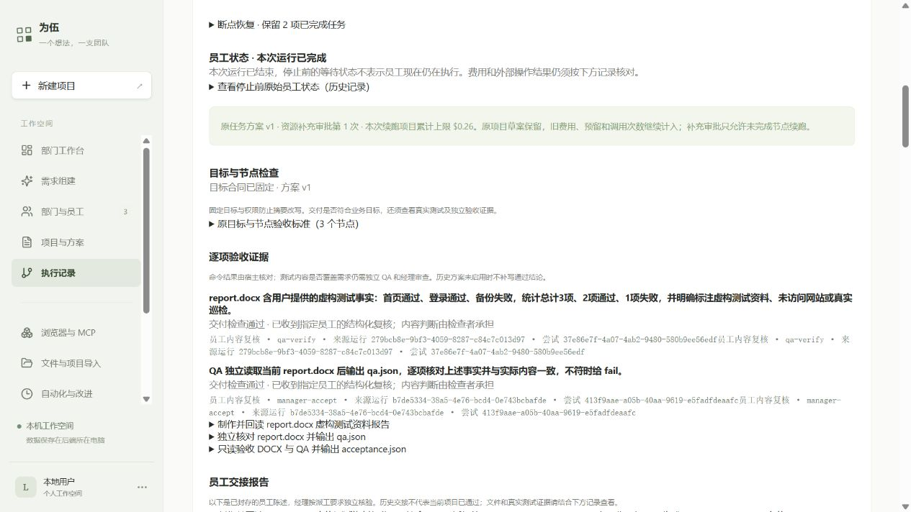

# 任务驱动组队：真实验收报告

日期：2026-10-19（北京时间）。本轮执行依据：[已批准安排](task-driven-organization-real-acceptance-proposal-2026-10-18.md)。

结论：**真实办公交付和恢复路径通过；首次组队方案生成质量未通过。** 本轮没有增加预算或权限，没有由 Codex 编写、修改员工的三个交付文件。不能将这一项办公小任务当作全部业务、任意插件或整个 MVP 全部验收完成。

## 已实际跑通的路径

用户需求 → 真实模型提出有效候选 → 明确确认已有部门与员工 → 创建一个项目 → 真实作者通过原版办公插件生成 Word → 作者交接后受控停止 → 重启服务 → 独立 QA → 经理检查与交付 → 网页查看、下载。

部门 `830c5454-a0d8-477c-912c-2273dfd2b7de` 的员工及版本仍为 v1；新项目 `38e2213f-4530-45ba-9308-87742b61b01a`。另外两类需求没有保存部门、创建项目或执行任务。

| 运行 | 实际结果 |
|---|---|
| `afc518f1-e2d3-4b0e-a8a0-c81155ac01de` | 作者 5 次真实调用，生成并回读 Word、正式交接。下一 QA 请求在费用预留和网络发送前暂停；正常停止服务后状态为 cancelled。 |
| `279bcb8e-9bf3-4059-8287-c84c7c013d97` | 重启后恢复作者结果。QA 6 次调用后通过；经理 3 次调用已读文件并写验收单，但自动上下文压缩请求超过原 96 KB 上限，未发送该请求。 |
| `b7de5334-38a5-4e76-bcd4-0e743bcbafde` | 原额度内 AI 重新分配经理资源、上下文调整至 117 KB，保留两个完成节点。经理再调用 4 次，正式交接成功，状态 completed。 |

本次恢复验证是**在明确安全边界受控暂停，然后正常停止并重启服务**，不是任意时刻杀进程或在外部写入中断网。验收专用暂停器仅作用于本项目，不制造模型响应；验证后原服务源文件按 SHA256 恢复。

使用已保存 OpenCode Go / `deepseek-v4.1-flash`。原生 `@huiliyi37/dsh-office@0.2.4` 的 `docx_create`、`docx_read` 有真实调用记录，执行回执显示 OpenShell 沙箱、Node v24.19.0、非 root 用户 1000、1 核/512 MiB。未增加终端、浏览器、外网、MCP 或公司知识权限。这里的三条巡检事实全为虚构测试资料，员工没有真实巡检网站。

## 实物与核对证据

目录：[本轮证据](evidence/task-driven-organization-2026-10-19/)。

| 原始员工文件 | 大小 | SHA256 |
|---|---:|---|
| [report.docx](evidence/task-driven-organization-2026-10-19/report.docx) | 10400 | `03a17d1e4390a03231995e4c403196bf9589c8e71ce5448e8d96b2908b81d13d` |
| [qa.json](evidence/task-driven-organization-2026-10-19/qa.json) | 2570 | `10a3a5765e26c2fc42aeeec68ccf23dab02cf3f8fadcbff265725b4786430489` |
| [acceptance.json](evidence/task-driven-organization-2026-10-19/acceptance.json) | 3450 | `0c3c9ef649b8606fd672217b4bd6bfe61309732f56512af5f645ecf92ef8f5e2` |

- `real-audit.json`：38 项只读检查通过，包括原 DAG、目标、人员、费用记录、完成节点、恢复先于新请求、文件版本、三份正式交接、最终文件及两项交付标准。它在第三类规划之前生成，里面的阶段费用不是最终总额。
- 原 Word 经两次恢复仍为同一 SHA256；作者没有重跑，QA 在最终续验中没有重跑。独立核对实际 DOCX ZIP/XML、三行事实、3/2/1 汇总及虚构资料声明；QA 和经理 JSON 的 verdict 均为 pass。
- `native-tool-evidence.json`：原生办公工具实际完成记录，不以模型口头陈述代替。
- `post-deploy.json`：修复后的恢复链 verified，两项交付标准均 passed，API 健康，活跃运行 0，用量记录 664 笔。
- `browser-result.json`、`browser-evidence.png`：真实网页显示 completed、恢复 QA 来源和两项通过，三份下载入口可见。通过网页实际下载到 Windows 的 `C:/Users/JJ/Downloads/report (2).docx`，SHA256 与上表相同。

完整原始运行档案、暂停/重启前后快照、资源方案与收据留在 JJ：
`/home/jj/.local/share/weiwu/validation/task-driven-organization-20261018/real-20261019/`。
生产运行档案仍在 `/home/jj/.local/share/weiwu/data/pilot/runs/`。仓库仅保存小型证据和虚构测试交付物，没有 API Key、进程环境或数据库备份。

## 规划质量抽检：明确保留失败

| 需求 | 首次结果 | 后续结果 |
|---|---|---|
| 三条虚构事实的 Word | 经理检查自身输出，候选被拒绝 | 两次纠正仍出现输入/输出合同和 JSON 问题；提示修复后第三次纠正生成有效 pipeline，最终真实交付通过 |
| 两份虚构统计汇总 | 把办公检查标为代码 review，候选被拒绝 | 保留失败；没有额外重试或执行 |
| 无终端权限的温度换算需求 | 能说明缺少运行测试权限，但候选引用无效/重复验收索引，被拒绝 | 保留失败；没有保存或执行 |

三类首次有效候选 **0/3**；含已授权 Word 纠正后，形成有效候选的需求 **1/3**。样本很小且跨提示修复前后，不作为通用成功率。服务端拒绝无效方案的门禁有效，**不等于模型规划质量通过**。温度样例还把“没有终端”泛化为“不能创建脚本”，忽略有文件写入能力员工可能仅写代码而不执行；其能力解释也需要继续改进。

下一项主问题应是减少模型生成合同的负担、把字段错误转成具体可纠正反馈，并在当前统一注册/授权方式下稳定生成可确认方案。按项目约定先调查现成结构化输出/规划实践，再列独立计划；本报告不声称已经实现，也不自动追加付费抽检。

## 本轮修复及回归

1. 无终端的办公组队不再套用代码 review 样例；提示明确个人工具授权、文件生产者合同、独立 QA 和最终经理职责。
2. 对明确支持的 DeepSeek V4/V4.1 路线启用 JSON mode，约束返回单个 JSON 对象；不拼接修补模型内容冒充有效方案。依据 [DeepSeek 官方 JSON Output](https://api-docs.deepseek.com/guides/json_mode/)。本项目资源规划已有同样机制，本轮复用到组织对话。
3. 恢复证据投影保留已封存的员工报告，修复“实际通过但网页未验证”。报告内容仍与原始档案严格比较；返工恢复附加的合同绑定另行核对，每次继承及网页使用前都校验，兼容正常返工。
4. 审查指出验收脚本此前只有阶段累计检查、没有单次规划硬上限。实际消耗未超额；已冻结历史付费入口，最后一次规划以单会话测试保护在费用登记与网络发送前核算完整请求，最高 $0.02，报价 $0.0133386。保护已移除，普通产品需求对话的“记录实际用量、不设项目费用门禁”行为不变。

| 验证 | 结果 |
|---|---|
| 最终规划、恢复证据、交接及验收脚本单测 | 27/27 通过；`final-unit.txt` |
| 组织对话、确认、恢复证据隔离接口 | 31/31（23+3+5）；`final-integration.txt` |
| 最终返工兼容修改后的接口复核 | 5/5；`lineage-api-final.txt`，与上一行重叠，不另算独立用例 |
| 类型检查 | `tsc --noEmit` 退出 0；`final-types.txt` 无错误输出 |
| Windows 与 JJ Vite 构建 | 均通过；保留已有 >500 KB 包体提醒 |
| 浏览器最终构建 | 实际加载 `index-CtIdbdPG.js`，两项通过、来源可追溯、Word 下载哈希一致 |

错误反例先失败再通过：DeepSeek JSON mode、恢复报告被剥离、合法返工恢复合同误比较。独立审查给出的费用边界与返工兼容问题均已修复；没有修改历史证据来消除错误。

## 费用、资源与限制

最终以 `final-summary.json` 为准：新增 **25 次真实调用**（3 次样例规划、3 次 Word 纠正、1 次资源规划、18 次员工执行），输入 **290780 Token**、输出 **21955 Token**。

- 阶段登记 **$0.11358 / $0.34**；其中三次样例规划 $0.013458，三次 Word 纠正 $0.0139143，项目执行及资源规划 $0.0862077。
- 项目仍最高 $0.26；另留纠正 $0.02，合计在已批准 $0.28 内。原累计授权 $3.41 不变；当前累计占用（含六笔旧未知预留）**$3.0084915**。
- 117 KB 的经理资源方案由真实 AI 生成。此前 118 KB×4 次请求的保守预留需 $0.2604648，超过 $0.26，在发送模型前被拒绝；117 KB×4 次加最高规划费为 $0.2592648，才获准继续。两次请求编号与拒绝记录均保留，不盲目重放。
- 不新增未知费用，不清零旧调用或已完成节点。以上为应用按配置单价登记的核算值，不等同于 OpenCode Go 包月套餐余额。
- 未验证：桌面 Word 的精确分页/排版、任意时刻强制崩溃、真实返工后的这组新交付标准、多进程 PostgreSQL 并发压力；不以 XML 完整或员工“通过”替代这些实测。
- 暂未实现：历史编排模板发布检索、任意运行中换人或重新规划、多个经理与无限递归团队。其他 MVP 项目的历史验收仍各自保留，本轮没有重做全部范围。

## 使用和继续入口

当前服务已发布 JJ，无活动任务。打开 [本次完成运行](http://127.0.0.1:4312/#run/b7de5334-38a5-4e76-bcd4-0e743bcbafde)，可查看逐项验收、继承报告、费用和下载。

新任务从「需求组建」勾选参与部门及能力，持续讨论，只有看到可确认方案才点击「确认方案并创建项目」，随后检查预算/权限并批准执行。失败候选可继续修改，不能跳过校验保存。Windows 页面依赖 SSH 隧道；断开时运行 `scripts/deployment/connect-jj.ps1`，JJ 用户服务独立持续运行。

本轮发布回退原文件位于 JJ 验证根目录的 `planning-fix-20261019/originals`、`lineage-fix-v2-20261019/originals`。保留已有发布的固定依赖目录，不删除原运行、知识和凭据。后续先解决规划质量，再扩大业务验收。
