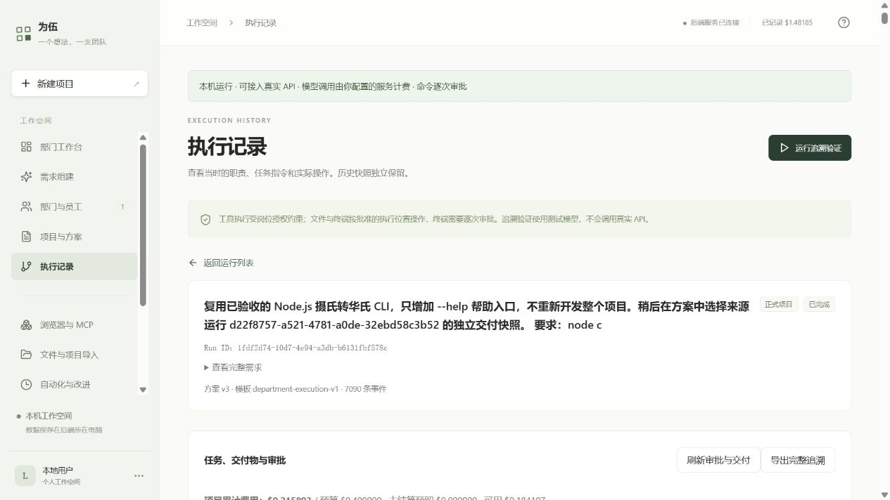

# 网页闭环、工作知识与资源治理验收

本阶段已完成真实网页小任务闭环和同任务知识复用对照；JJ 可运行，Windows 用户用网页独立操作。没有手改业务数据库或由 Codex 补写员工交付。完整长期运行和自动经验升级仍不宣布完成。

## 真实闭环与交付

用户在网页复用旧 CLI，经理持续两轮对话；未确认的候选不执行。前两份候选因合同问题被拒绝/丢弃，费用保留；第三份真实 AI 候选确认后，项目 v3 开发、独立 QA、经理完成。交付 `cli.mjs`、`README.md`、旧 `cli.test.mjs`、新增 `help.test.mjs` 均由员工生成或复用原员工版本。

首次运行 `1fdf2d74-10d7-4e94-a3db-b6131fbf578c`：独立 QA 一次错误测试失败，员工自行修正，最终原17/17、新4/4。经理独立复测两份测试并提交正式 pass。开发首次带 `echo` 的命令申请被拒绝，随后申请单条 Node 语法检查通过。过早的协调“不通过/不可判定”消息保留，正式验收只使用节点完成后封存的质量 verdict；协调消息体验仍有改进空间。

网页下载 CLI SHA `9105a499636d1a83239882bfa3fb76369ad2626f1aa62952e0f442389163536e` 与封存一致。Windows Node 24.19.0 对实际下载副本复测21/21，见 [复测输出](evidence/userflow-2026-10-10/employee-artifacts/windows-recheck.txt)。此项是 Codex 独立复核，与 JJ 上员工真实验收分别标记。

复用运行 `5825ba34-8451-4cf5-a30e-30454e699948` 也完成；QA 首次17+4全通过，经理再独立17+4并正式 pass。两套交付与完整命令字节见 [首次](evidence/userflow-2026-10-10/proof.json)、[复用](evidence/userflow-2026-10-10/reused/proof.json)。操作说明见 [使用说明](../delivery-acceptance-quickstart.md)。

## 已修复问题

- 经理补充对话未进入重规划：加入来源消息与哈希；新对话使未确认候选失效，待回复阻止额外规划；长窗口遗漏明确披露。
- 上游写新文件、下游却绑定旧 SHA：新候选拒绝不可能的固定输入；旧成果保持兼容。
- AI 验收合同遗漏映射或 Node 最低测试数，以及 Node 参数绕过：生成和确认门禁拒绝，工程回归覆盖。
- 完成文件难以复用：网页从正式封存运行生成哈希匹配快照，重复选择幂等，不导入临时文件。
- 工作难以沉淀：复用已有运行索引与知识版本，登记需求、节点、实际命令/测试、交付版本及量化指标；定向私有资料不扩大为部门共享。
- 高频轮询重复保存完整团队：宿主轮询引用前次结果哈希，变化、错误和员工实际读取仍完整记录。
- 增长缺准入保护：运行64MiB/总1GiB，工作知识500份/8MiB，原导入200份/128MiB；超限保留历史，阻止新增工作。
- 复用收益难核对：加入首次对照、重叠审批去重、实际发送收据、未知量缺省和恢复分段排除；真实结果与负收益均保存。

## 知识、费用与恢复

两份真实工作知识登记到来源部门，重复登记 existing，没有额外版本副本。授权员工检索有真实版本/行号；运行固定源文档 v1，三位员工实际检索和读取。[量化报告](knowledge-reuse-measurement-2026-10-10.md)：Token减少1.94%、登记费用减少1.37%，扣除审批等待后耗时增加2.85%，不能宣传普遍加速。

本轮没有重跑此前已经通过的中断恢复：父 `2079d91d-9017-444e-9846-50f8b47a24ba` → 子 `d22f8757-a521-4781-a0de-32ebd58c3b52`；已完成 QA 零新增模型调用、DAG/预算/固定文件和上下文保留，经理继续独立验收。完整证据见 [重启恢复报告](delivery-acceptance-2026-10-10.md)。

最新完整备份通过：`/home/jj/.local/share/weiwu/backups/userflow-20261010T103134Z-c6b84ad3.tar.gz`，35,120,134字节、模式0600，SHA `5743c51df449566a604684de77a9c57e20df780579ce9878a267002e5042121d`。原卷440,995,383字节/1,739文件；两项服务都停止后，原卷、归档、隔离提取的全部初始字节一致。恢复实验只在 `/home/jj/.local/share/weiwu/data/restore-checks/userflow-20261010T103134Z-c6b84ad3/pilot`，PGlite 两次只读重开全表指纹相同，309用量、两份工作知识v1与旧未知预留均匹配；OpenRig SQLite完整性ok。副本未启动服务、设备或模型，原环境未被覆盖。原服务和OpenRig均恢复，原项目/账本/知识不变；[重启后真实知识引用](evidence/userflow-2026-10-10/citation-after-restart.json)仍返回固定v1。

备份过程保留两次未通过记录：[首次](evidence/userflow-2026-10-10/backup-first-failure.json)只停为伍而OpenRig仍写SQLite，初始字节不一致；[第二次](evidence/userflow-2026-10-10/backup-prior-failure.json)初始复制和数据库读取已通过，但重启追加日志触发过严的不变断言。最后复用第二份副本、没有再次停服/复制；核对历史日志前缀仍相同，明确记录重启新追加1208/588字节，数据库/会话元数据恢复运行后的正常变化另行标注。[最终验证](evidence/userflow-2026-10-10/backup-verified.json)是成功依据，旧失败不改写。在线50MiB解密体积限制仍在，大卷需使用离线方法。

## 工程与发布

受影响隔离回归21规划、20组织对话、6经理对话、3工作登记、3备份扩展、24规划UI、17文件示例、3文件授权、4合同门禁、1对话窗口、4效率统计通过。状态轮询和存储准入通过；原生及模型结算8项正常退出通过。类型检查、网页构建通过（既有大chunk警告保留）。普通全量需要独立PostgreSQL；并发资源争用/环境失败的尝试未计作通过。工程测试的模型夹具仅验证代码，真实验收只认上述两次实际 Go 请求与 OpenShell 命令。

JJ最新发布 `/home/jj/.local/share/weiwu/releases/weiwu-userflow6-20261010`，发布PID1164279，最新备份恢复后PID1253405。部署从userflow4经完整5到指标修正6，发布前后3项目/279用量一致，部署调用0；旧发布与数据保留。之后真实对照增加1项目/30用量，累计309行；全局已知$1.6737561、旧未知$0.0192111保留，未超$2。[构建](evidence/userflow-2026-10-10/build.txt)、[集成](evidence/userflow-2026-10-10/engineering-integration.txt)、[结算](evidence/userflow-2026-10-10/engineering-settlement.txt)、[效率回归](evidence/userflow-2026-10-10/engineering-efficiency.txt)。

## 尚未完成与限制

这次验证 Windows 网页连接 JJ；不是 Windows 原生 OS 沙箱验收。限额是应用准入，非 OS 磁盘硬限额，在途写入仍可能超过软上限；任意 Obsidian 编辑和全部数据库增长未受这些限额完整约束。工作记录归档是隐藏与保留关联，不是图上自动重接边。未自动把经验升级为 Skill/工具，也未完成长任务完整目标监督与持续部门调度。大档案在线备份仍有限制；本次最新离线备份的恢复副本只验证数据，没有启动第二套员工服务。

